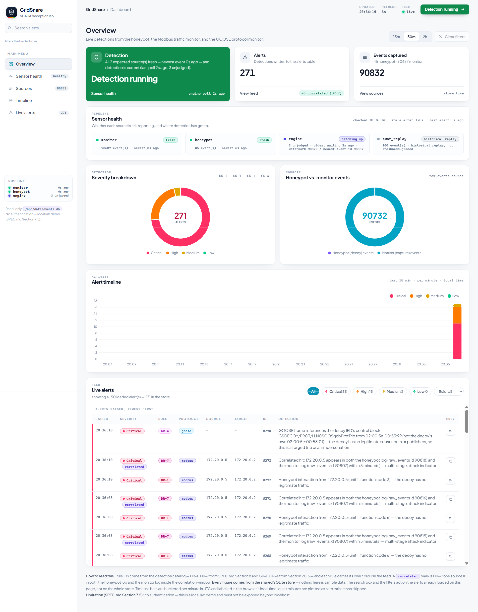
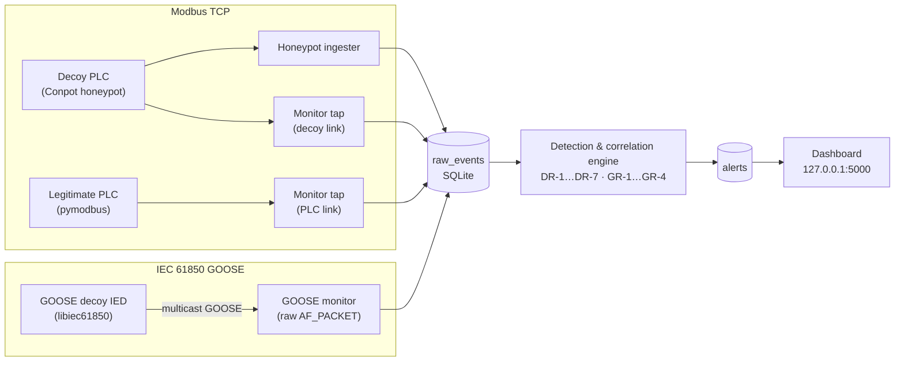
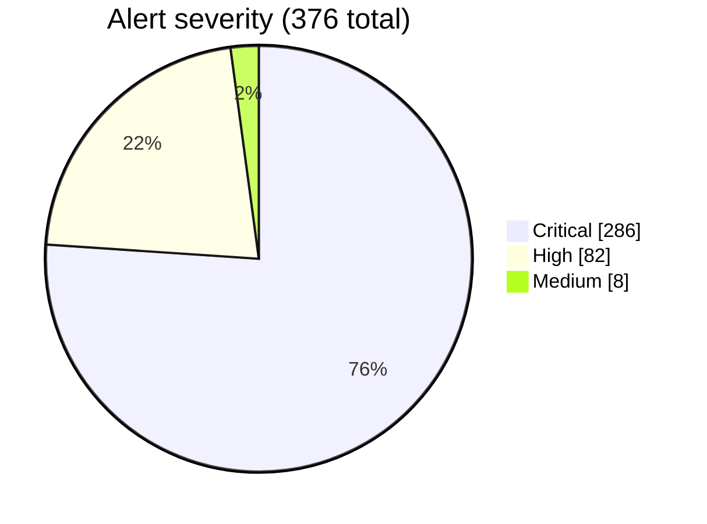

<div align="center">

# 🛡️ GridSnare

**SCADA/ICS deception and anomaly detection for Modbus TCP and IEC 61850 GOOSE**


-brightgreen)


[Quick start](#quick-start) ·
[Architecture](#architecture) ·
[Detection rules](#detection-rules) ·
[Results](#measured-results) ·
[Known limitations](#known-limitations) ·
[Spec](docs/SPEC.md)

</div>

---

GridSnare pairs **deception** (decoy PLC and decoy protection relay) with **protocol-aware
detection** on two industrial protocols, and correlates both into one severity-ranked alert
stream on a single dashboard. It runs entirely in Docker, on an isolated lab network, with one
command.

> **Lab-only.** No real production SCADA or HVDC system is ever touched. See
> [Security and responsible use](#security-and-responsible-use).
>
> **[`docs/SPEC.md`](docs/SPEC.md)** is the technical source of truth (architecture, detection
> logic, constraints). This README is the entry point.

<div align="center">



<sub>The dashboard on a live lab run (2026-09-29, 20:36 local time). The feed shows a GOOSE
decoy-contact alert (GR-4) alongside Modbus alerts (DR-1 honeypot hits and DR-7 correlated hits).
Counts here come from a different point in time than the 376-alert TC-6 snapshot used in
<a href="#measured-results">Measured results</a>.</sub>

</div>

## Contents

- [Highlights](#highlights)
- [Architecture](#architecture)
- [Quick start](#quick-start)
- [Dashboard](#dashboard)
- [Detection rules](#detection-rules)
- [Configuration](#configuration)
- [Testing](#testing)
- [Measured results](#measured-results)
- [Real-world validation (GR-5)](#real-world-validation-gr-5)
- [Network topology](#network-topology)
- [Project structure](#project-structure)
- [Tech stack](#tech-stack)
- [Roadmap](#roadmap)
- [Known limitations](#known-limitations)
- [Security and responsible use](#security-and-responsible-use)
- [Contributing](#contributing)
- [Documentation and references](#documentation-and-references)
- [License](#license)

## Highlights

| | |
|---|---|
| 🔀 **Dual-protocol coverage** | Most open-source ICS honeypots stop at Modbus. GridSnare also decodes and detects on IEC 61850 GOOSE: layer 2, multicast, no IP address to lean on. |
| 🔗 **Correlation, not just alerting** | DR-7 links an independent honeypot interaction to an independent network observation into one high-confidence Critical alert, which cuts noise without hiding new findings. |
| 🎯 **A genuine false-positive baseline** | Baseline traffic targets a real, non-decoy PLC, not the honeypot, so the 0-false-positive result means what it says. |
| ⚙️ **Config-driven detection** | Every threshold (DR-1…DR-7, GR-1…GR-4) lives in `config.yaml`, not in code. |
| 🐳 **One-command lab** | `docker compose up -d` starts every service (decoys, legitimate assets, monitors, engine, dashboard) with detection running and heartbeating before any test traffic is sent. |
| 🧪 **Evidence-only reporting** | No metric, pass/fail result, or claim in this repo is asserted without a real run behind it ([SPEC §18](docs/SPEC.md)). |

## Architecture

- **Modbus TCP:** a Conpot-based honeypot plus an independent traffic monitor, watching
  a decoy PLC and a real (non-decoy) PLC simulator side by side.
- **IEC 61850 / GOOSE:** a decoy IED that publishes and subscribes to GOOSE messages,
  with a passive protocol-level monitor observing the substation bus.

Both feeds land in one shared event store. A detection and correlation engine, running as its
own persistent service, turns them into alerts.



**Data flow.** Monitors and the honeypot ingester write structured events to `raw_events`
(tagged `protocol = modbus | goose`). The engine polls on an interval, applies the rule set,
and writes matches to `alerts` with a rule ID and severity. The dashboard reads both tables.

## Quick start

Everything runs in Docker. Nothing is installed on the host.

**Prerequisites:** Docker with Compose v2 (`docker compose`), and a free port `5000` on
`127.0.0.1`. The optional GR-5 model additionally needs the SWaT dataset (see
[Real-world validation](#real-world-validation-gr-5)).

```bash
# 1. Bring up the lab. This also starts the detection engine as its own service,
#    polling on its configured interval. There is no manual engine step.
docker compose up -d

# 2. Open the dashboard (bound to 127.0.0.1 only)
#    http://127.0.0.1:5000

# 3. Run the full validation and test plan
docker compose --profile test run --rm tests
```

Watch detection live with `docker compose logs -f engine`. The dashboard's **Sensor health**
panel reports `Detection running` while the engine's heartbeat is fresh.

Stop the lab with `docker compose down`. The event store persists in the `gridsnare_data`
volume.

<details>
<summary>Observe GOOSE traffic independently from inside the lab network</summary>

```bash
docker run --rm --network gridsnare_scada_net --cap-add NET_RAW \
  -v "$(pwd)/tests:/probe:ro" python:3.12-slim \
  python /probe/goose_lab.py --interface eth0 capture --seconds 12
```

</details>

<details>
<summary>Troubleshooting: DR-4 is not firing when it should</summary>

Check your shell for leftover overrides:

```bash
env | grep GRIDSNARE_OPERATIONAL_
```

A `GRIDSNARE_OPERATIONAL_START`, `_END`, or `_TZ` left over from an off-hours test run widens
or shifts the window DR-4 judges, which disables off-hours detection by design. The engine logs
the window it is using on every startup:

```bash
docker compose logs engine | grep OPERATIONAL-HOURS
```

Clear it with `unset` on the variables, then `docker compose up -d engine`.

</details>

## Dashboard

Open `http://127.0.0.1:5000` once the stack is up. The page refreshes itself every 3 seconds and
reads the shared SQLite store **read-only**.

| View | What it shows |
|---|---|
| **Overview** | Detection status, alert total (with the DR-7 correlated count), and events captured split into honeypot and monitor |
| **Sensor health** | Per-source freshness for `monitor`, `honeypot`, and `engine` (with its unjudged-event backlog), plus `swat_replay` marked as *historical replay* and never freshness-graded |
| **Sources** | Event counts by origin (honeypot vs monitor) |
| **Timeline** | Alerts per minute over the last 30 minutes, stacked by severity |
| **Live alerts** | Newest-first feed with time, severity, rule ID, protocol tag (`modbus` / `goose`), source, target, alert ID, and a plain-language detection message; one-click copy per row |

- **Filters:** a 15 m / 30 m / 2 h time window, severity chips, a rule selector, and a search box.
  The search box and filters act on the alerts already loaded on the page (the latest 50), not
  the whole store. The feed header shows both numbers, for example "showing all 50 loaded
  alert(s), 271 in the store".
- **Detection status card** reports how fresh each expected source is, how long ago the engine
  last polled, and how many events are still unjudged.
- **Timeline buckets** are computed per minute in UTC and labelled in the browser's local time.
- The dashboard has **no authentication**. Keep it on localhost.

## Detection rules

Thresholds, allow-lists, and hour windows are configurable in `config.yaml`. Rule definitions
and rationale: [SPEC §8](docs/SPEC.md) (Modbus) and [SPEC §20.3](docs/SPEC.md) (GOOSE).

**Modbus (`protocol = modbus`)**

| ID | Rule | Severity |
|---|---|---|
| DR-1 | Any interaction with the honeypot | Critical |
| DR-2 | Function code outside the allow-list | High |
| DR-3 | Write to a register outside the operational range | High |
| DR-4 | Access outside operational hours | Medium |
| DR-5 | Source IP not on the known-asset allow-list | Medium |
| DR-6 | Abnormally high polling frequency from one source | Medium |
| DR-7 | Same source IP seen in both honeypot and monitor logs within N minutes | Critical |

**IEC 61850 GOOSE (`protocol = goose`)**

| ID | Rule | Indicates | Severity |
|---|---|---|---|
| GR-1 | StNum/SqNum sequence violation | Replayed frame | High |
| GR-2 | Source MAC not on the publisher allow-list for that GoCB | Spoofing | Critical |
| GR-3 | Retransmission rate outside the configured timing profile | Rogue or malfunctioning publisher | Medium |
| GR-4 | Any GOOSE traffic referencing the decoy IED's GoCB | Decoy contact | Critical |
| GR-5 *(stretch)* | Autoencoder reconstruction error above a trained threshold | Statistical anomaly the rules miss | Medium to Critical (scaled) |

GR-5 is an **offline SWaT-replay evaluation**, not a live detector. The rules are what the
running stack decides with ([SPEC §17](docs/SPEC.md)).

## Configuration

| Setting | Where | Default | Purpose |
|---|---|---|---|
| Allow-lists, operational hours, polling limits, DR-3 ranges | `config.yaml` | See file | All Modbus rule thresholds |
| `engine.detection.operational_hours` | `config.yaml` | 06:00–20:00 `Asia/Kolkata` | Window DR-4 treats as normal operation |
| `engine.goose.timing_max_frames_per_window` | `config.yaml` | 120 frames per trailing 5 s (30 s cooldown) | GR-3 threshold |
| `dashboard.historical_sources` | `config.yaml` | See file | Replayed sources that are never freshness-graded |
| `GRIDSNARE_OPERATIONAL_START` / `_END` / `_TZ` | Environment | Empty | Override the DR-4 window without editing `config.yaml` |

## Testing

Validation follows [SPEC §12 and §20.6](docs/SPEC.md): **13 automated integration cases** in
`tests/test_scenarios.py`, run end-to-end against the live stack and asserted against the same
SQLite store and dashboard API an operator would read.

```bash
docker compose --profile test run --rm tests
```

| Case | Expected result | Outcome |
|---|---|---|
| TC-1 · Honeypot detection | Event logged, DR-1 fires, Critical alert | ✅ Pass |
| TC-2 · Baseline (no false positive) | No alerts in 10 minutes of whitelisted traffic | ✅ Pass · 40/40 requests observed, 0 alerts |
| TC-3 · Function-code anomaly | DR-2 fires, High alert | ✅ Pass |
| TC-4 · Out-of-range write | DR-3 fires, High alert | ✅ Pass |
| TC-5 · Correlation | DR-7 fires, Critical alert, both events linked | ✅ Pass |
| TC-6 · Dashboard accuracy | Dashboard counts match `alerts` table exactly | ✅ Pass |
| TC-7 · Decoy GoCB detection | GR-4 fires, Critical alert | ✅ Pass · frame built from the decoy's identity, sent from a link address that is not the decoy's |
| TC-8 · GOOSE baseline (no false positive) | No GOOSE alerts from legitimate publisher traffic | ✅ Pass · burst and heartbeat captured, ≥2 distinct StNums seen, **0** alerts of any kind |
| TC-9 · Replay detection | GR-1 fires, High alert | ✅ Pass · legitimate frame re-sent out of its place |
| TC-10 · Spoofing detection | GR-2 fires, Critical alert | ✅ Pass · publisher's GoCB claimed from a MAC not on its allow-list |
| TC-11 · Timing anomaly | GR-3 fires, Medium alert | ✅ Pass · hundreds of frames sent where the profile allows 8 over ~2.3 s |
| TC-13 · Unified dashboard | Both protocols shown, tagged correctly, no cross-contamination | ✅ Pass · alert row, its event, and the dashboard feed all agree |
| TC-14 · Historical sources not graded | Replayed `swat_replay` rows never degrade sensor health | ✅ Pass · pipeline `healthy` while `swat_replay` reads 3927 d stale |

TC-12 (GR-5 out-of-distribution vector) is documented but **not automated**. GR-5's behaviour
is reported by the replay run instead.

TC-7, TC-9, TC-10, TC-11, and TC-13 capture real frames off the lab segment, re-send them, and
assert on what the independent GOOSE monitor recorded. The cases drive the live stack rather
than a second implementation of the wire format.

### Run the full plan at any hour

TC-2 only means something inside the window DR-4 treats as operational hours (committed as
06:00–20:00 `Asia/Kolkata`). Outside it, the same whitelisted traffic *is* out-of-hours
activity, so DR-4 fires by design and TC-2 **skips** rather than asserting "no alerts". Every
DR-4 alert this lab has ever raised was exactly that: the suite's own baseline at 21:36, 22:28,
and 22:33 IST.

```bash
# all 13 cases, at any hour, without editing config.yaml
export GRIDSNARE_OPERATIONAL_START=00:00 GRIDSNARE_OPERATIONAL_END=23:59 \
  && docker compose up -d engine \
  && docker compose --profile test run --rm tests python -m pytest tests/test_scenarios.py -v
```

`docker compose up -d engine` is the half that matters: DR-4 is judged by the persistent
`engine` service from its own config load, so the override must reach that container, not just
the test runner. When finished, put the engine back on the committed window:

```bash
unset GRIDSNARE_OPERATIONAL_START GRIDSNARE_OPERATIONAL_END && docker compose up -d engine
```

<details>
<summary>Details: startup log lines, verification status, edge cases</summary>

The engine reports which window it will use on **every** startup where any override variable is
set, including when the value matches `config.yaml`.

```text
OPERATIONAL-HOURS OVERRIDE ACTIVE for this process: DR-4 will judge activity against
00:00-23:59 Asia/Kolkata, not the configured 06:00-20:00 Asia/Kolkata
(GRIDSNARE_OPERATIONAL_START='00:00', GRIDSNARE_OPERATIONAL_END='23:59'). DR-4 therefore will
not fire where it normally would, and config.yaml on disk is unchanged. ...
```

If the variables match the values `config.yaml` already declares, the line changes instead of
disappearing:

```text
OPERATIONAL-HOURS OVERRIDE PRESENT BUT INERT: GRIDSNARE_OPERATIONAL_START='06:00',
GRIDSNARE_OPERATIONAL_END='20:00' is set, but the window it declares (06:00-20:00 Asia/Kolkata)
is the configured one (06:00-20:00 Asia/Kolkata), so DR-4 behaves normally here. ...
```

**Verified:** the wiring. The `engine` container carries all three variable names, its startup
log reports `hours=00:00-23:59 Asia/Kolkata` when they are exported and
`hours=06:00-20:00 Asia/Kolkata` when they are not, and the window TC-2 tests against follows
the same variables.

**Not yet measured:** the end-to-end off-hours run itself. The command above was exercised at
08:48 IST, inside the window, where TC-2 runs either way, so that run says nothing about the
override. The hours in which DR-4 previously fired on this baseline (21:36–22:33 IST) are the
ones to run it in.

**Defaults and edge cases.** The variables are declared in `docker-compose.yml` for both
services with an empty default, so a plain `docker compose up -d` uses the committed window.
`GRIDSNARE_OPERATIONAL_TZ` reads the window in another zone. `00:00`–`23:59` covers every hour
except two minutes a day, starting 23:49 IST and 23:59 IST, where TC-2's 600-second baseline
would no longer *end* inside the same window. Start anywhere else, or pass a wrapping window
(for example `23:58`/`23:57`), and the case runs.

</details>

## Measured results

*Every figure is a measured result from a real run in this lab, not a target or an estimate.*

| Metric | Result |
|---|---|
| Modbus test suite | **6/6** cases passing across 6 independent full runs (TC-1 … TC-6) |
| GOOSE test suite | **7/7** cases passing on the current tree (TC-7 … TC-11, TC-13, TC-14) |
| Full suite, current tree | **13/13 passed in 656.8 s**, no case skipped. TC-2 passed for real: **40/40** baseline requests observed, 0 alerts, 0 DR-4. The run started at 08:48 IST, inside the window, so it is evidence about the suite, not about the override |
| Off-hours DR-4 false positives | **3**, which is every DR-4 alert this lab has ever raised: the suite's own baseline judged out-of-hours at 21:36 / 22:28 / 22:33 IST |
| GOOSE detection rules | **GR-1 … GR-4** implemented, config-driven, each firing on real injected frames |
| GR-5 on SWaT | **78.74%** detection at **5.07%** FPR (43,007 / 54,621 attack rows; 10,548 / 208,066 held-out normal rows) |
| False positives eliminated | **80 → 0** after the legitimate PLC baseline was added |
| Alert correlation rate | **37.2%** of all alerts (140 / 376) automatically linked across sources |
| Sustained event throughput | **~56 events/sec** (838 queued events processed in 15 s, warmed) |
| Data migration integrity | **178 / 178** rows preserved, identical IDs, zero loss |
| Storage reliability fix | **5/5 → 0/5** failed cross-container store opens |
| Store-locking incidents | **0** `database is locked` errors after the store moved onto a Docker volume, including a GR-5 replay writing 100 rows and 100 alerts while the stack was live |

**Alert severity distribution** (TC-6 snapshot, 376 alerts):



*Low: 0, omitted from the chart but not from the count.*

<details>
<summary>How the metrics relate: three linked engineering fixes</summary>

| Change | Before | After | What it unlocked |
|---|---|---|---|
| Added a real, non-decoy PLC baseline ([SPEC §11](docs/SPEC.md)) | 40 baseline reads → **80 false positives** (every read *was* honeypot traffic) | 40/40 observed, **0 alerts** | Made the TC-6 severity breakdown trustworthy: those 376 alerts reflect genuine anomalies, not baseline noise |
| Switched SQLite from WAL to a rollback journal (later followed by the move to a named volume, see [Known limitations](#known-limitations)) | **5/5** failed opens from fresh containers on the bind mount | **0/5** failures, verified under concurrent read/write | Removed a hidden reliability ceiling the next fix (persistent engine) would otherwise have hit constantly |
| Made the engine a persistent compose service | Backlog scaled with uptime. 838 queued events cleared in 15 s warmed, but a colder or larger backlog exceeded the 60 s test timeout | Continuous polling, no backlog accumulation | Suite run time dropped ~2% (622.5 s → 609.6 s avg) and no longer depends on when a human starts detection |

Together: the false-positive fix made the correlation metric (37.2% linked) meaningful, the
storage fix made the service architecture reliable enough to run unattended, and the service
architecture is what let the suite pass **six times in a row** rather than once by luck of
timing.

**Run-time comparison** (full 6-case suite, three runs each):

| Engine mode | Runs (seconds) | Average |
|---|---|---|
| Started by hand | 632.48 · 619.72 · 615.33 | 622.51 s |
| Running as a persistent service | 607.66 · 608.80 · 612.24 | 609.57 s |

</details>

<details>
<summary>Per-case evidence (Modbus cases)</summary>

- **TC-1:** an FC 3 read to the decoy was captured, ingested, and produced `['DR-1', 'DR-7']`.
- **TC-2:** 40 whitelisted reads over 600 s to the real PLC (5/min, half of DR-6's limit): 40/40 observed, 0 alerts, **0** DR-4 rows. Measured at 08:48 IST, inside the configured window; the override was exported for that run but was not what made the case pass.
- **TC-3:** FC 43 (Read Device Identification) to the decoy produced `[('DR-2', 'High')]`.
- **TC-4:** FC 6 write of 16962 to register 59 (range 0–9) produced DR-2, DR-3, DR-7, and DR-1.
- **TC-5:** an out-of-range write and the resulting honeypot hit were linked by DR-7 into one Critical alert.
- **TC-6:** dashboard and `alerts` table agreed exactly: total 376, Critical 286 / High 82 / Medium 8 / Low 0, correlated 140, all 50 feed rows identical.

</details>

## Real-world validation (GR-5)

GR-5 is an unsupervised reconstruction-error detector: a small PyTorch autoencoder trained on
the public iTrust/SUTD **SWaT** (Secure Water Treatment) testbed captures in `data/swat/`,
run through `scripts/train_autoencoder.py`. Every figure below is the output of the run
recorded on this machine on 2026-09-28.

**Setup.** 51 numeric sensor/actuator columns (`Timestamp` and the `Normal/Attack` label
dropped), standardised on the training split, missing cells imputed with training column
medians. Architecture `51 → 32 → 16 → 32 → 51`, MSE reconstruction error as the anomaly score,
Adam at `1e-3`, 1024-row batches, 40 epochs, seed 42. `normal.csv` (1,387,098 rows) is split
70/15/15 into train / validation / test. The threshold is the validation quantile that targets
a 5% false-positive rate.

| Metric | Measured result |
|---|---|
| Training reduction | **0.180163 → 0.007152** MSE (**96.0%**); best validation MSE **0.006555** at epoch 40 |
| Calibrated threshold | **0.018779** (validation FPR **5.0004%**, 5% target) |
| False positive rate (held-out normal split) | **5.07%** (10,548 / 208,066 normal rows flagged) |
| Detection rate (attack rows flagged) | **78.74%** (43,007 / 54,621) |
| Flagged severity mix | Critical 39,860 · High 181 · Medium 2,382 · Low 584 |

**Reading the numbers honestly**

- `attack.csv` is 54,621 rows, all labelled `Attack`; `normal.csv` is 1,387,098 rows, all
  labelled `Normal`. The false-positive rate is therefore measured on the held-out normal
  split, not on the attack capture, which contains no normal rows.
- The threshold is calibrated on the validation split, so its 5.0004% is by construction. The
  **5.07%** held-out measurement is the honest headline.
- 7 of the 51 columns are ~71.5% missing in `normal.csv` (none in `attack.csv`) and are
  median-imputed. This is a property of the published SWaT captures.

**Pipeline integration.** Flagged rows are replayed into the shared store as
`source='swat_replay'`, `protocol='modbus'`, with a matching `GR-5` alert whose severity scales
with how far the reconstruction error exceeds the threshold (≥6× Critical, ≥3× High, ≥1.5×
Medium, otherwise Low). The replay is capped at **100 rows** and replaces any previous sample on
each run: the engine judges events in a single serial pass and commits once per cycle (a couple
of events per second in this lab), so a 43,007-row backlog would take hours to drain while
teaching the detector nothing the first 100 rows did not. The stored sample was the first 100
flagged attack rows, which graded 91 Critical / 9 High.

**Reproduce it** (inside a container, like every other component):

```bash
# trains, evaluates, writes data/autoencoder.pt, replays 100 flagged rows into the store
docker compose --profile gr5 run --rm gr5

# metrics only, nothing written to the store
docker compose --profile gr5 run --rm gr5 python scripts/train_autoencoder.py --no-store
```

The SWaT captures total ~400 MB and are **not committed**. Place `normal.csv` and `attack.csv`
under `data/swat/` before running. The trained model `data/autoencoder.pt` is a build artefact
and is gitignored. `gr5/Dockerfile` installs CPU-only PyTorch (1.46 GB image, versus ~3 GB for a
CUDA build with a GPU this model cannot use). The run must happen in a container because it
writes to the shared store while the stack holds it open (see [Known limitations](#known-limitations)).

## Network topology

| Component | Address | Notes |
|---|---|---|
| Dashboard | `127.0.0.1:5000` | Host-bound only |
| Decoy Modbus | `172.20.0.2:5020` | Conpot's `testing` template: 5020, not 502 |
| Decoy HTTP | `172.20.0.2:8800` | Same template |
| Legitimate PLC | `172.20.0.6:502` | Real asset; baseline traffic target ([SPEC §11](docs/SPEC.md)); no store access |
| Modbus monitor (decoy link) | Shares decoy's namespace | Passive tap, both directions |
| Modbus monitor (PLC link) | Shares PLC's namespace | Required separately: a bridge doesn't deliver another container's unicast to a passive observer |
| GOOSE decoy IED | `172.20.0.3`, MAC `02:00:5e:00:53:01` | Publishes to `01:0c:cd:01:00:01`, appId `0x3001` |
| Legitimate GOOSE publisher | `172.20.0.7`, MAC `02:00:5e:00:53:02` | Real relay's publishing half; the MAC is the whole of GR-2's allow-list for `GSBASE/PROT$gcbProtTrip` |
| GOOSE monitor | `172.20.0.4` | Passive; joins the multicast group itself, `NET_RAW` only |
| Test client | `172.20.0.5` | Fixed address, allow-listed baseline source |
| Data store | `gridsnare_data` volume → `/app/data/events.db` | SQLite on a Docker named volume, mounted read-write into every service that needs it (`config.yaml` unchanged) |
| Host-mounted inputs | `./data/swat/`, `./data/autoencoder.pt` | Bind-mounted over the volume: host artefacts, not database state |

## Project structure

Abbreviated. The full tree is in [SPEC §19](docs/SPEC.md).

```text
GridSnare/
├── docs/
│   ├── SPEC.md                 # technical specification (source of truth)
│   └── img/dashboard.png       # README screenshot
├── honeypot/conpot_config/     # Conpot decoy PLC configuration
├── monitor/traffic_monitor.py  # Scapy Modbus TCP capture and parsing
├── goose/                      # GOOSE: decoy_ied.py, goose_monitor.py
├── engine/
│   ├── rules.py                # DR-1 … DR-7
│   ├── goose_rules.py          # GR-1 … GR-5
│   ├── autoencoder.py          # optional PyTorch model (GR-5)
│   └── correlator.py
├── dashboard/                  # Flask app and templates
├── gr5/Dockerfile              # GR-5 runner: CPU PyTorch (Compose profile `gr5`)
├── scripts/train_autoencoder.py
├── data/                       # host-mounted inputs only (swat/, autoencoder.pt)
├── tests/test_scenarios.py     # 13 automated integration cases
├── config.yaml                 # all detection thresholds
└── requirements.txt
```

## Tech stack

| Tool | Role |
|---|---|
|  | All services: honeypot, GOOSE decoy, monitors, engine, dashboard |
|  | Monitors, detection engine, dashboard |
|  | ICS honeypot (decoy PLC) |
|  | GOOSE decoy IED and legitimate publisher (built in-image) |
|  | Optional GR-5 autoencoder (stretch goal) |
|  | Shared event and alert store |
|  | Optional manual traffic inspection |

The dashboard is Flask with Chart.js ([SPEC §10](docs/SPEC.md)); Modbus capture uses Scapy.

## Roadmap

**Modbus TCP** ([SPEC §6-18](docs/SPEC.md)): **complete**

- [x] Isolated honeypot and monitor network
- [x] Honeypot logging and ingestion into the shared store
- [x] Legitimate PLC baseline with its own monitor tap
- [x] Live Modbus TCP capture and parsing (Scapy)
- [x] Detection rules DR-1…DR-6, config-driven thresholds
- [x] Correlation logic (DR-7)
- [x] Live dashboard (alerts, severity, timeline)
- [x] Detection engine as its own service
- [x] All 6 test cases passing on 3+ runs
- [x] Dashboard screenshot in the repo (`docs/img/dashboard.png`)
- [ ] Short screen recording of a simulated attack caught end to end ([SPEC §14](docs/SPEC.md))

**IEC 61850 GOOSE** ([SPEC §20](docs/SPEC.md)): **complete**, except the items marked open

- [x] `goose` service with libiec61850 built in-image
- [x] Decoy IED publishing GOOSE
- [x] Decoy IED subscribing (own `AF_PACKET` path, see limitations)
- [x] Legitimate GOOSE publisher, distinct from the decoy IED (TC-8 has nothing to watch without it)
- [x] GOOSE monitor parsing StNum / SqNum / MAC / GoCB
- [x] Events tagged by protocol (`modbus` / `goose`)
- [x] Detection rules GR-1…GR-4, config-driven thresholds
- [x] Unified dashboard across both protocols
- [x] Test cases TC-7…TC-11, TC-13, and TC-14 (historical-source regression)
- [x] *(Stretch)* GR-5 autoencoder built and measured
- [ ] *(Stretch)* Automated TC-12 case for GR-5 (its behaviour is currently reported by the replay run, not asserted by the suite)
- [ ] GOOSE event retention policy (the monitor records every heartbeat frame by design)

## Known limitations

Honest, current gaps, kept here rather than smoothed over, per the project's
[integrity policy](docs/SPEC.md).

- DR-5 is IP-only. A MAC-based check would need the monitor to also record `Ether.src`.
- DR-3's coil range (FC 5/15) is an implementation extension beyond SPEC's literal "register" wording.
- DR-3's address ranges are lab defaults, not measurements of a real device profile.
- `libiec61850`'s own GOOSE receive path delivers nothing on this build (bounded by direct measurement). The decoy's subscribe side uses a raw `AF_PACKET` socket instead, with the same publisher API for sending.
- No positive automated test yet proves DR-4 fires on real off-hours traffic; only its absence is tested.
- The GOOSE monitor records every heartbeat frame by design (GR-1 and GR-3 need them), so the store grows without bound in a long-running lab. No retention policy is implemented.
- The dashboard is single-host with no authentication: fine for a local demo, not production-ready.

<details>
<summary><b>GR-1 cannot distinguish a legitimate publisher restart from a replay</b></summary>

The rule is sequence-only. It fires High when a publisher's StNum goes backwards or its SqNum
stops advancing, and a real publisher that restarts does exactly that, because its StNum begins
again at 1.

Measured here: restarting the legitimate publisher mid-run (`docker compose restart
goose-publisher`, stack otherwise untouched) produced:

```text
GR-1 High · GOOSE sequence violation from 02:00:5e:00:53:02 on GSBASE/PROT/LLN0$GO$gcbProtTrip: StNum went backwards from 4495 to 1
```

The frames on the wire were that publisher's honest heartbeat. Separating the two needs state a
GOOSE frame does not carry (a boot time, or a `timeAllowedToLive` cross-check). It is stated
rather than suppressed, because a rule that ignored backward StNums would be blind to an actual
replay.

</details>

<details>
<summary><b>GR-3's threshold is calibrated to this lab, not to a standard</b></summary>

It flags more than `engine.goose.timing_max_frames_per_window: 120` frames per trailing 5 s
window (30 s cooldown), a figure taken from this lab's own capture path and publisher profile:
an 8-frame burst over ~2.3 s on a state change, then a 2 s heartbeat. A real substation's
profile, a faster publisher, or a different capture path would need its own calibration. The
rule is a **rate** check; it does not implement IEC 61850's retransmission curve.

</details>

<details>
<summary><b>Resolved: the shared store used to fail under concurrent writers</b></summary>

On the `./data` bind mount (the Docker Desktop filesystem share), five containers opened one
SQLite database read-write and repeated `sqlite3.OperationalError: database is locked`
followed. In the worst incident the file became unwritable for every container while the
Windows host could still open it, because that share does not provide the POSIX locking SQLite
relies on. The store was also created with `PRAGMA journal_mode=DELETE` (`store.py` cannot mmap
a `-shm` file across the share), so every commit rewrote the database in place and widened the
window further.

It now lives on a Docker named volume (`gridsnare_data`) mounted at the unchanged container
path `/app/data`; `config.yaml` was not touched. Only `data/swat/` and `data/autoencoder.pt`
are bind-mounted back over it, because a 400 MB read-only dataset and a 24 KB artefact are host
inputs rather than database state.

Measured after the move: **0** `database is locked` errors across the full suite, the GR-5
replay (100 rows + 100 alerts written while the stack was live), and hours of normal operation.

Leftovers kept in place rather than deleted: the old bind-mount store (`data/events.db`,
~45 MB) and `data/honeypot_ingest.offset`, neither of which is read by anything any more. The
ingester treats a missing offset as "first run" and starts at the end of the decoy's log, so
the new volume does not trigger a re-ingest of everything Conpot ever logged.

</details>

<details>
<summary><b>The store is no longer written from the host while the stack is up</b></summary>

The GR-5 runner is a container for exactly that reason: a host-side
`python scripts/train_autoencoder.py` would write, across the filesystem share, to a database
that five containers hold open, which is the arrangement that produced the incidents above.

Its entrypoint also turns the one failure this mount shape can introduce into a clear message:
`data/autoencoder.pt` is gitignored, so on a fresh clone Docker creates a *directory* at that
path instead of a file. The check says so rather than letting the save fail after a full
training run.

</details>

The same limitations are summarized in [`docs/SPEC.md`](docs/SPEC.md) §17, and measured status
against each success criterion is in §21.

## Security and responsible use

- All testing runs on an isolated lab network of containers you own. There is no internet
  exposure at any point.
- The dashboard binds to `127.0.0.1` only and has **no authentication**. Do not expose it
  beyond localhost.
- All "attack" traffic is self-generated inside the lab. Nothing is sourced from, or aimed at,
  third parties.
- No real production SCADA, HVDC, or utility infrastructure is accessed, simulated with real
  identifying data, or referenced.
- This is a lab and educational project. It makes no claim of production deployment,
  certification, or real-world incident detection ([SPEC §4 and §18](docs/SPEC.md)).

## Contributing

1. Read [`docs/SPEC.md`](docs/SPEC.md) completely before writing code. Architecture, rule IDs,
   and file layout are defined there (§6-9 Modbus, §20 GOOSE).
2. Follow the build order in §15. Get the Modbus tests in §12 passing before starting GOOSE
   work.
3. Everything runs in Docker. No host-level Python packages or system dependencies.
4. Quote the relevant SPEC rule ID and description in a comment above any detection rule you
   implement.
5. Report only what a real run in this environment actually produced (§18 Content Integrity
   Policy).
6. If SPEC conflicts with something more convenient to build, stop and ask rather than
   deviating silently.

## Documentation and references

- **[`docs/SPEC.md`](docs/SPEC.md):** full technical specification, detection logic, constraints,
  and the current status against success criteria.
- [Conpot](https://github.com/mushorg/conpot): ICS honeypot
- [libiec61850](https://github.com/mz-automation/libiec61850): open-source IEC 61850 (MMS, GOOSE, Sampled Values) library
- [SWaT dataset](https://itrust.sutd.edu.sg/): iTrust, Singapore University of Technology and Design
- IEC 62443, NIST SP 800-82, and MITRE ATT&CK for ICS: design and vocabulary references ([SPEC §5.3](docs/SPEC.md))

## License

No license has been specified yet. Until a `LICENSE` file is added, default copyright applies
and others have no explicit right to use, modify, or redistribute this code.

---

<div align="center">

**Lab-isolated only. No real production SCADA/HVDC system is ever touched.**

</div>
