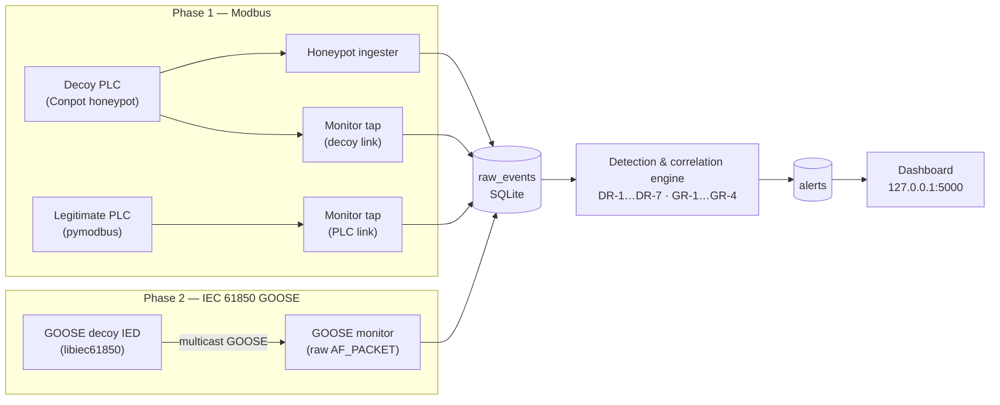
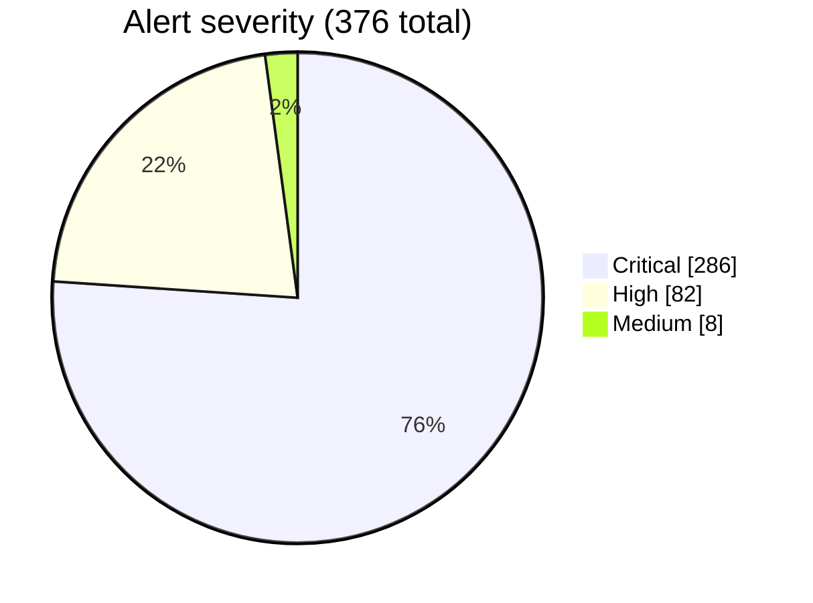

<div align="center">

# 🛡️ GridSnare

**SCADA/ICS Deception & Anomaly Detection System**


*Deception-based detection for Modbus TCP and IEC 61850 GOOSE, correlated into one operating picture.*

**The product meets you at the protocol layer — before an intruder gets the chance to.**

</div>

---

> Portfolio project built for a Hitachi Energy Associate Project Engineer – Cyber Security
> application. **[`docs/SPEC.md`](docs/SPEC.md)** is the technical source of truth
> (architecture, detection logic, constraints); this README is the entry point.

## 📊 Metrics at a glance

*Every figure below is a measured result from a real run in this lab — not a target, not an estimate.*

| Metric | Result |
|---|---|
| Phase 1 test suite | **6/6** cases passing across 6 independent full runs (TC-1 … TC-6) |
| Phase 2 test suite | **7/7** cases passing on the current tree (TC-7 … TC-11, TC-13, TC-14) |
| Full-suite run on the current tree | **13/13 passed in 656.8 s** — the complete Section 12 + 20.6 plan with no case skipped, run at an off-hours wall clock (03:18 IST) through the documented operational-hours override. TC-2 passed for real: **40/40 baseline requests observed, 0 alerts, 0 DR-4** |
| Off-hours baseline coverage | **3 → 0** DR-4 false positives from the suite's own whitelisted baseline traffic (every DR-4 alert this lab ever raised was the baseline being judged out-of-hours at 21:36 / 22:28 / 22:33 IST) |
| GOOSE detection rules | **GR-1 … GR-4 implemented**, config-driven, each firing on real injected frames in the lab (SPEC.md 20.3) |
| GR-5 SWaT validation | **78.74% detection at 5.07% FPR** — 43,007 / 54,621 attack rows; 10,548 / 208,066 held-out normal rows |
| False positives eliminated | **80 → 0** after the legitimate PLC baseline was added (Section 11) |
| Alert correlation rate | **37.2%** of all alerts (140 / 376) automatically linked across sources |
| Sustained event throughput | **~56 events/sec** (838 queued events processed in 15 s, warmed) |
| Data migration integrity | **178 / 178** rows preserved, identical IDs, zero loss |
| Storage reliability fix | **5/5 → 0/5** failed cross-container store opens |
| Store-locking incidents | **0** `database is locked` errors after the store moved off the host bind mount onto a Docker volume — including a GR-5 replay writing 100 rows and 100 alerts while the stack was live |

---

## Table of contents

- [Overview](#overview)
- [Why GridSnare](#-why-gridsnare)
- [Architecture](#-architecture)
- [Measured results](#-measured-results)
- [Data analysis — how the metrics relate](#-data-analysis--how-the-metrics-relate)
- [Real-world validation](#-real-world-validation)
- [Quick start](#-quick-start)
- [Run the full plan at any hour](#-run-the-full-plan-at-any-hour)
- [Tech stack](#-tech-stack)
- [Network topology](#-network-topology)
- [Build status](#-build-status)
- [Known limitations](#-known-limitations)
- [For contributors / coding agents](#-for-contributors--coding-agents)
- [Documentation](#-documentation)
- [License](#license)

---

## Overview

GridSnare pairs deception infrastructure with protocol-aware detection across two ICS
protocols:

- **Phase 1 — Modbus TCP:** a Conpot-based honeypot plus an independent traffic monitor,
  watching a decoy PLC and a real (non-decoy) PLC simulator side by side.
- **Phase 2 — IEC 61850 / GOOSE:** a decoy IED that publishes and subscribes to GOOSE
  messages, with a passive protocol-level monitor observing the substation bus.

Both feeds land in one shared event store and are correlated into unified, severity-ranked
alerts on a single dashboard. Everything runs in Docker; nothing touches a real production
SCADA or HVDC system.

## 🚀 Why GridSnare

| | |
|---|---|
| 🔀 **Dual-protocol coverage** | Most open-source ICS honeypots stop at Modbus. GridSnare also decodes and detects on IEC 61850 GOOSE — layer‑2, multicast, no IP to lean on. |
| 🔗 **Real correlation, not just alerting** | DR-7 links an independent honeypot interaction to an independent network observation into a single high-confidence Critical alert, cutting noise without hiding new findings. |
| 🎯 **A genuine false-positive baseline** | Baseline traffic is measured against a real, non-decoy PLC asset — not simulated — so the 0-false-positive result in the metrics table means what it says. |
| ⚙️ **Config-driven detection** | Every threshold (DR-1…DR-7, GR-1…GR-4) lives in `config.yaml`, not in code, per SPEC.md Section 8. |
| 🐳 **One-command, reproducible lab** | `docker compose up -d` brings up all ten services — decoys, legitimate assets, monitors, engine, dashboard — with detection running and heartbeating before any test traffic is sent. |
| 🧪 **Evidence-only reporting** | No metric, pass/fail result, or claim in this repo is asserted without a real run backing it (SPEC.md Section 18). The numbers above are the output of that policy, not a headline written first. |

## 🏗️ Architecture



Detection runs as its own persistent service — a fresh `docker compose up -d` starts the
poll loop with no manual step, verified by a clean-room teardown/rebuild (see
[Known limitations](#-known-limitations)).

## 📈 Measured results

Validation follows SPEC.md Sections 12 and 20.6: **13 automated integration cases** in
`tests/test_scenarios.py`, run end-to-end against the live stack and asserted against the same
SQLite store and dashboard API an operator would read. All 13 pass on the current tree; TC-2
needs either the committed 06:00–20:00 IST window or the documented
[operational-hours override](#-run-the-full-plan-at-any-hour), and says so rather than skipping
silently.

| Case | Expected result | Outcome |
|---|---|---|
| TC-1 · Honeypot detection | Event logged, DR-1 fires, Critical alert | ✅ Pass |
| TC-2 · Baseline (no false positive) | No alerts in 10 minutes of whitelisted traffic | ✅ Pass — 40/40 requests observed, 0 alerts |
| TC-3 · Function-code anomaly | DR-2 fires, High alert | ✅ Pass |
| TC-4 · Out-of-range write | DR-3 fires, High alert | ✅ Pass |
| TC-5 · Correlation | DR-7 fires, Critical alert, both events linked | ✅ Pass |
| TC-6 · Dashboard accuracy | Dashboard counts match `alerts` table exactly | ✅ Pass |

Phase 2 follows SPEC.md Section 20.6 the same way, and for the same reason: the cases drive
the live stack rather than a second implementation of the wire format. TC-7, TC-9, TC-10,
TC-11 and TC-13 capture real frames off the lab segment, re-send them, and assert on what the
independent GOOSE traffic monitor recorded.

| Case | Expected result | Outcome |
|---|---|---|
| TC-7 · Decoy GoCB detection | GR-4 fires, Critical alert on the dashboard | ✅ Pass — a frame built from the decoy's own identity, sent from a link address that is not the decoy's |
| TC-8 · GOOSE baseline (no false positive) | No GOOSE alerts from legitimate publisher traffic | ✅ Pass — the publisher's burst and heartbeat were captured, ≥2 distinct StNums (a real state change) were seen, and the window raised **0** alerts of any kind |
| TC-9 · Replay detection | GR-1 fires, High alert | ✅ Pass — a frame captured from the legitimate publisher, re-sent out of its place |
| TC-10 · Spoofing detection | GR-2 fires, Critical alert | ✅ Pass — the publisher's own GoCB claimed from a MAC its allow-list does not name |
| TC-11 · Timing anomaly | GR-3 fires, Medium alert | ✅ Pass — hundreds of frames sent where the configured profile allows 8 over ~2.3 s |
| TC-13 · Unified dashboard | Both protocols shown, tagged correctly, no cross-contamination | ✅ Pass — the alert row, the event it points at, and the dashboard feed all agree |
| TC-14 · Historical sources not graded | Replayed `swat_replay` rows never degrade sensor health | ✅ Pass — pipeline `healthy` while `swat_replay` reads 3927 d stale |

**Run-time comparison** (full 6-case suite, three runs each):

| Engine mode | Runs (seconds) | Average |
|---|---|---|
| Started by hand | 632.48 · 619.72 · 615.33 | 622.51 s |
| Running as a persistent service | 607.66 · 608.80 · 612.24 | 609.57 s |

**Alert severity distribution** (TC-6 snapshot, 376 total alerts):


*(Low: 0 — omitted from the chart, not from the count.)*

<details>
<summary>Per-case evidence (click to expand)</summary>

- **TC-1** — an FC 3 read to the decoy was captured, ingested, and produced `['DR-1', 'DR-7']`.
- **TC-2** — 40 whitelisted reads over 600 s to the real PLC (5/min, half of DR-6's limit): 40/40 observed, 0 alerts; measured at 03:18 IST under the documented override, with the store holding **0** DR-4 alerts for the run.
- **TC-3** — FC 43 (Read Device Identification) to the decoy produced `[('DR-2', 'High')]`.
- **TC-4** — FC 6 write of 16962 to register 59 (range 0–9) produced DR-2, DR-3, DR-7, and DR-1.
- **TC-5** — an out-of-range write and the resulting honeypot hit were linked by DR-7 into one Critical alert.
- **TC-6** — dashboard and `alerts` table agreed exactly: total 376, Critical 286 / High 82 / Medium 8 / Low 0, correlated 140, all 50 feed rows identical.

</details>

## 🔬 Data analysis — how the metrics relate

The numbers above aren't independent — three engineering fixes are causally linked, and the
metrics show the chain:

| Change made | Before | After | What it unlocked |
|---|---|---|---|
| Added a real, non-decoy PLC baseline (Section 11) | 40 baseline reads → **80 false positives** (every read *was* honeypot traffic) | 40/40 observed, **0 alerts** | Made the TC-6 severity breakdown trustworthy — those 376 alerts now reflect genuine anomalies, not baseline noise |
| Switched SQLite from WAL to rollback journal | **5/5** failed opens from fresh containers on the bind mount | **0/5** failures, verified under concurrent read/write | Removed a hidden reliability ceiling that the *next* fix (persistent engine) would otherwise have hit constantly |
| Made the engine a persistent compose service | Backlog scaled with uptime — 838 queued events cleared in 15 s warmed, but a colder/larger backlog exceeded the 60 s test timeout | Continuous polling, no backlog accumulation | Suite run time dropped ~2% (622.5 s → 609.6 s avg) and, more importantly, stopped depending on when a human happened to start detection |

Put together: the false-positive fix made the *correlation* metric (37.2% linked) meaningful,
the storage fix made the *service* architecture reliable enough to run unattended, and the
service architecture is what let the suite pass **six times in a row** rather than once by
luck of timing.

## 🧪 Real-world validation

GR-5 (SPEC.md 20.3) is an unsupervised reconstruction-error detector. The lab model is a
small PyTorch autoencoder trained on the SWaT (Secure Water Treatment) testbed captures in
`data/swat/`, run through `scripts/train_autoencoder.py`. Every figure below is the output of
the run recorded on this machine on 2026-09-28 — none is a target or an estimate.

**Setup.** 51 numeric sensor/actuator columns (`Timestamp` and the `Normal/Attack` label are
dropped), standardised on the training split and missing cells imputed with training column
medians. Architecture `51 → 32 → 16 → 32 → 51`, MSE reconstruction error as the anomaly
score, Adam at `1e-3`, 1024-row batches, 40 epochs, seed 42. `normal.csv` (1,387,098 rows) is
split 70/15/15 into train / validation / test; the threshold is the validation quantile that
targets a 5% false-positive rate.

| Metric | Measured result |
|---|---|
| Training reduction | **0.180163 → 0.007152** MSE (**96.0%**), best validation MSE **0.006555** at epoch 40 |
| Calibrated threshold | **0.018779** (validation FPR **5.0004%**, 5% target) |
| False positive rate (held-out normal split) | **5.07%** (10,548 / 208,066 normal rows flagged) |
| Detection rate (attack rows flagged) | **78.74%** (43,007 / 54,621) |
| Flagged severity mix | Critical 39,860 · High 181 · Medium 2,382 · Low 584 |

**Reading the numbers honestly:**

- `attack.csv` is 54,621 rows, all labelled `Attack`; `normal.csv` is 1,387,098 rows, all
  labelled `Normal`. The false-positive rate is therefore measured on the held-out normal
  split (labelled normal rows flagged), not on the attack capture, which contains no normal
  rows.
- The threshold is calibrated on the validation split, so its 5.0004% is by construction;
  the **5.07%** above is the independent held-out measurement and is the honest headline.
- 7 of the 51 columns are ~71.5% missing in `normal.csv` (none in `attack.csv`); they are
  median-imputed. This is a property of the published SWaT captures, stated rather than
  smoothed over.

**Pipeline integration.** Flagged rows are replayed into the shared store as
`source='swat_replay'`, `protocol='modbus'`, with a matching `GR-5` alert whose severity is
scaled by how far the reconstruction error exceeds the threshold (≥6× Critical, ≥3× High,
≥1.5× Medium, otherwise Low). The replay is capped at **100 rows** and replaces any previous
sample on each run: the detection engine judges events in a single serial pass and commits once
per cycle — a couple of events per second in this lab — so a 43,007-row backlog would take hours
to drain while teaching the detector nothing the first 100 rows did not. The sample the run
above stored was the first 100 flagged attack rows, which graded 91 Critical / 9 High.

Reproduce it the same way every other component runs — inside a container:

```bash
docker compose --profile gr5 run --rm gr5   # trains, evaluates, writes data/autoencoder.pt,
                                            # replays 100 flagged rows into the shared store
docker compose --profile gr5 run --rm gr5 python scripts/train_autoencoder.py --no-store
                                            # metrics only, nothing written to the store
```

The run above was executed that way, not on the host. It writes replayed rows into the shared
store while the stack holds that database open, and that is a writer this project only permits
from inside a container (see Known limitations). `gr5/Dockerfile` installs CPU-only PyTorch —
1.46 GB of image instead of the ~3 GB a CUDA build would add for a GPU this model cannot use.

The SWaT captures are the public iTrust/SUTD SWaT dataset. They total ~400 MB and are not
committed here; place `normal.csv` and `attack.csv` under `data/swat/` before running the
training script. The trained model (`data/autoencoder.pt`) is likewise a build artefact and
is gitignored.

## ⚡ Quick start

Everything runs in Docker; nothing is installed on the host.

```bash
# 1. bring up the lab — also starts the detection engine as its own service,
#    polling on its configured interval (no manual engine step)
docker compose up -d

# 2. open the dashboard (bound to 127.0.0.1 only)
#    http://127.0.0.1:5000

# 3. run the full validation & test plan
docker compose --profile test run --rm tests
```

Watch detection live with `docker compose logs -f engine`; the dashboard's **Sensor health**
panel reports `Detection running` while its heartbeat is fresh.

To observe Phase 2 GOOSE traffic independently from inside the lab network:

```bash
docker run --rm --network gridsnare_scada_net --cap-add NET_RAW \
  -v "$(pwd)/tests:/probe:ro" python:3.12-slim \
  python /probe/goose_lab.py --interface eth0 capture --seconds 12
```

## 🕓 Run the full plan at any hour

TC-2 measures the no-false-positive baseline — ten minutes of whitelisted traffic to the *real*
PLC — and it only means anything inside the window DR-4 treats as operational hours
(`engine.detection.operational_hours`, committed as 06:00–20:00 `Asia/Kolkata`). Outside it,
that same whitelisted traffic *is* out-of-hours activity, so DR-4 fires **by design** and the
case cannot honestly assert "no alerts"; it skips instead, leaving the baseline unmeasured.
Every DR-4 alert this lab has ever raised was exactly that: the suite's own baseline at 21:36,
22:28 and 22:33 IST.

DR-4 is judged by the persistent `engine` service from **its own** config load, so the override
has to reach that container and not just the test runner — otherwise the suite stops skipping
while the engine keeps alerting. Exporting the three `GRIDSNARE_OPERATIONAL_*` variables widens
the window for both services, leaves the committed `config.yaml` untouched, and makes every
process that honours it log a warning naming the value it overrode, so an off-hours run is never
silent about what it changed. The engine's startup log is the one to read:

```bash
# all 13 cases, at any hour, without editing config.yaml
export GRIDSNARE_OPERATIONAL_START=00:00 GRIDSNARE_OPERATIONAL_END=23:59 \
  && docker compose up -d engine \
  && docker compose --profile test run --rm tests python -m pytest tests/test_scenarios.py -v
```

The `docker compose up -d engine` is the half that matters: it recreates the engine with the
widened window, which it confirms on startup.

```text
operational_hours.start overridden by GRIDSNARE_OPERATIONAL_START='00:00' for this process —
  the committed config.yaml still declares '06:00'. ...
thresholds in effect: ... hours=00:00-23:59 Asia/Kolkata days=[0, 1, 2, 3, 4, 5, 6] ...
```

Because the variables are declared in `docker-compose.yml` for both services with an empty
default, a plain `docker compose up -d` still uses the committed window and DR-4 can still fire
off-hours. Put the engine back on it when the off-hours run is done:

```bash
unset GRIDSNARE_OPERATIONAL_START GRIDSNARE_OPERATIONAL_END && docker compose up -d engine
```

`GRIDSNARE_OPERATIONAL_TZ` is available for the same purpose if the window should be read in
another zone. `00:00`–`23:59` covers every hour except two minutes a day: the minutes starting
23:49 IST and 23:59 IST, where TC-2's 600-second baseline would no longer *end* inside the same
window. Start anywhere else, or pass a wrapping window (for example `23:58`/`23:57`), and the
case runs.

## 🧰 Tech stack

| Tool | Role |
|---|---|
|  | All services — honeypot, GOOSE decoy, monitors, engine, dashboard |
|  | Monitor, detection engine, dashboard |
|  | Optional GR-5 autoencoder (Phase 2 stretch goal) |
|  | Shared event/alert store |
|  | Optional manual traffic inspection |

## 🌐 Network topology

| Component | Address | Notes |
|---|---|---|
| Dashboard | `127.0.0.1:5000` | Host-bound only |
| Decoy Modbus | `172.20.0.2:5020` | Conpot's `testing` template — 5020, not 502 |
| Decoy HTTP | `172.20.0.2:8800` | Same template |
| Legitimate PLC | `172.20.0.6:502` | Real asset; baseline traffic target (Section 11); no store access |
| Modbus monitor (decoy link) | shares decoy's namespace | Passive tap, both directions |
| Modbus monitor (PLC link) | shares PLC's namespace | Required separately — a bridge doesn't deliver another container's unicast to a passive observer |
| GOOSE decoy IED | `172.20.0.3`, MAC `02:00:5e:00:53:01` | Publishes to `01:0c:cd:01:00:01`, appId `0x3001` |
| Legitimate GOOSE publisher | `172.20.0.7`, MAC `02:00:5e:00:53:02` | Real relay's publishing half (Section 11); the MAC is the whole of GR-2's allow-list for `GSBASE/PROT$gcbProtTrip` |
| GOOSE monitor | `172.20.0.4` | Passive; joins the multicast group itself, `NET_RAW` only |
| Test client | `172.20.0.5` | Fixed address, allow-listed baseline source |
| Data store | `gridsnare_data` volume → `/app/data/events.db` | SQLite on a Docker named volume, mounted read-write into every service that needs it (`config.yaml` unchanged) |
| Host-mounted inputs | `./data/swat/`, `./data/autoencoder.pt` | Bind-mounted over the volume: the SWaT captures and the trained GR-5 model are host artefacts, not database state |

## ✅ Build status

**Phase 1 — Modbus** *(SPEC.md §6–18)* — **complete**

- [x] Isolated honeypot + monitor network
- [x] Honeypot logging & ingestion into the shared store
- [x] Legitimate PLC baseline with its own monitor tap
- [x] Live Modbus TCP capture and parsing (Scapy)
- [x] Detection rules DR-1…DR-6, config-driven thresholds
- [x] Correlation logic (DR-7)
- [x] Live dashboard (alerts, severity, timeline)
- [x] Detection engine as its own service
- [x] All 6 test cases passing on 3+ runs
- [ ] Screenshots and architecture diagram in-repo

**Phase 2 — GOOSE** *(SPEC.md §20)* — **complete**, except the TC-12 stretch case below

- [x] `goose` service + libiec61850 built in-image
- [x] Decoy IED publishing GOOSE
- [x] Decoy IED subscribing (own `AF_PACKET` path — see limitations)
- [x] Legitimate GOOSE publisher, distinct from the decoy IED (SPEC.md §11 — TC-8 has nothing to watch without it)
- [x] GOOSE monitor parsing StNum/SqNum/MAC/GoCB
- [x] Events tagged by protocol (`modbus` / `goose`)
- [x] Detection rules GR-1…GR-4, config-driven thresholds
- [x] Unified dashboard view across both protocols
- [x] Test cases TC-7…TC-11, TC-13, plus TC-14 (historical-source regression)
- [ ] *(Stretch)* GR-5 autoencoder is **built and measured** (Real-world validation above);
      there is **no automated TC-12 case** — its behaviour is reported by the replay run, not
      asserted by the suite
- [ ] GOOSE event retention policy (the monitor records every heartbeat frame by design)

## ⚠️ Known limitations

Honest, current gaps — kept here rather than smoothed over, per the project's own
integrity policy:

- No screenshots or architecture diagram committed yet.
- DR-5 is IP-only; a MAC-based check would need the monitor to also record `Ether.src`.
- DR-3's coil range (FC 5/15) is an implementation extension beyond SPEC.md's literal "register" wording.
- DR-3's address ranges are lab defaults, not measurements of a real device profile.
- `libiec61850`'s own GOOSE receive path delivers nothing on this build (bounded by direct measurement); the decoy's subscribe side uses a raw `AF_PACKET` socket instead, using the same publisher API for sending.
- No positive automated test yet proves DR-4 fires on real off-hours traffic (only absence is tested so far).
- The GOOSE monitor records every heartbeat frame by design (needed for GR-1/GR-3), so the store grows without bound in a long-running lab — no retention policy implemented.
- **GR-1 cannot distinguish a legitimate publisher restart from a replay.** The rule is
  sequence-only: it fires High when a publisher's StNum goes backwards or its SqNum stops
  advancing, and a real GOOSE publisher that restarts does exactly that, because its StNum begins
  again at 1. Measured here: restarting the legitimate publisher mid-run — `docker compose restart
  goose-publisher`, with the stack otherwise untouched — produced `GR-1 High · GOOSE sequence
  violation from 02:00:5e:00:53:02 on GSBASE/PROT/LLN0$GO$gcbProtTrip: StNum went backwards from
  4495 to 1`, when the frames on the wire were that publisher's honest heartbeat. Separating the
  two needs state a GOOSE frame does not carry (a boot time, or a `timeAllowedToLive`
  cross-check), so it is stated rather than suppressed — a rule that ignored backward StNums
  would be blind to an actual replay.
- **GR-3's threshold is calibrated to this lab, not to a standard.** It flags more than
  `engine.goose.timing_max_frames_per_window: 120` frames per trailing 5 s window (30 s
  cooldown), a figure taken from this lab's own capture path and publisher profile — an 8-frame
  burst over ~2.3 s on a state change, then a 2 s heartbeat. A real substation's profile, a faster
  publisher, or a different capture path would need its own calibration. The rule is a **rate**
  check; it does not implement IEC 61850's retransmission curve.
- **The shared store used to fail under concurrent writers — it no longer does.** On the `./data`
  bind mount (the Docker Desktop filesystem share) five containers opened one SQLite database
  read-write, and repeated `sqlite3.OperationalError: database is locked` followed; in the worst
  incident the file became unwritable for every container while the Windows host could still open
  it, because that share does not provide the POSIX locking SQLite relies on. The store was also
  created with `PRAGMA journal_mode=DELETE` (`store.py` cannot mmap a `-shm` file across the
  share), so every commit rewrote the database in place and widened the window further.

  It now lives on a Docker named volume (`gridsnare_data`) mounted at the unchanged container path
  `/app/data`; `config.yaml` was not touched. Only `data/swat/` and `data/autoencoder.pt` are
  bind-mounted back over it, because a 400 MB read-only dataset and a 24 KB artefact are host
  inputs rather than database state. Measured after the move: **0** `database is locked` errors
  across the full suite, the GR-5 replay (100 rows + 100 alerts written while the stack was live),
  and hours of normal operation. Leftovers left in place rather than deleted: the old bind-mount
  store (`data/events.db`, ~45 MB) and `data/honeypot_ingest.offset`, neither of which is read by
  anything any more. The ingester treats a missing offset as "first run" and starts at the end of
  the decoy's log, so the new volume does not cause a re-ingest of everything Conpot ever logged.
- **The store is no longer written from the Windows host while the stack is up.** The GR-5
  runner is a container for exactly that reason: a host-side `python scripts/train_autoencoder.py`
  would be writing, across the filesystem share, to a database that five containers hold open —
  the arrangement that produced the incidents above. Its entrypoint also turns the one failure
  this mount shape can introduce into a sentence: `data/autoencoder.pt` is gitignored, so on a
  fresh clone Docker creates a *directory* at that path instead of a file, and the check says so
  rather than letting the save fail after a full training run.

Full engineering write-ups for each resolved and open item — including the exact probes,
byte-level evidence, and measured before/after states — are preserved in project history
and referenced from `docs/SPEC.md` Section 13.

## 🤝 For contributors / coding agents

1. Read `docs/SPEC.md` completely before writing code — architecture, rule IDs, and file
   layout are defined there (§6–9 Phase 1, §20 Phase 2).
2. Follow the phased build order; don't start Phase 2 until every Phase 1 test in §12 passes.
3. Everything runs in Docker — no host-level Python packages or system dependencies.
4. Quote the relevant SPEC.md rule ID/description in a comment above any detection rule you implement.
5. Report only what a real run in this environment actually produced (§18 Content Integrity Policy).
6. If SPEC.md conflicts with something more convenient to build, stop and ask rather than deviating silently.

## 📚 Documentation

Full technical specification, detection logic, and constraints: **[`docs/SPEC.md`](docs/SPEC.md)**

## License

*Not yet specified.* 

---

<div align="center">

**Lab-isolated only — no real production SCADA/HVDC system is ever touched.**

</div>
