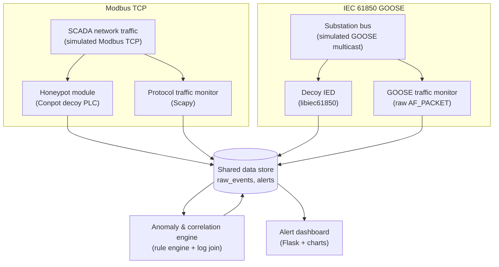

# GridSnare: Technical Design Specification

This document is the source of truth for architecture, detection logic, and constraints. For the
project overview, quick start, and measured metrics, see [`README.md`](../README.md).

## Document Control

| Field | Value |
|---|---|
| Project name | GridSnare (SCADA Deception & Anomaly Detection System) |
| Naming | One name throughout. The public/display name is "GridSnare"; code, folders, Docker services and images, loggers, and environment variables use "gridsnare" / "GRIDSNARE" |
| Document version | 1.2 |
| Last updated | 2026-09-29 |
| Status | Approved for build. Both the Modbus TCP and the IEC 61850 GOOSE sides are implemented and validated. The stretch test case TC-12 is not automated (see [Section 21](#21-current-status-against-success-criteria)) |
| Purpose | Independent cybersecurity research project on SCADA/ICS deception (honeypots) and anomaly detection across Modbus and IEC 61850/GOOSE |
| Classification | Educational / lab use only. No production or third-party systems are involved |

## Table of contents

1. [Executive Summary](#1-executive-summary)
2. [Problem Statement](#2-problem-statement)
3. [Scope](#3-scope)
4. [Rules of Engagement](#4-rules-of-engagement)
5. [Threat Model](#5-threat-model)
6. [System Architecture](#6-system-architecture)
7. [Module Specifications](#7-module-specifications)
8. [Detection Logic](#8-detection-logic)
9. [Data Flow](#9-data-flow)
10. [Technology Stack](#10-technology-stack)
11. [Test Environment Setup](#11-test-environment-setup)
12. [Validation & Test Plan](#12-validation--test-plan)
13. [Success Criteria](#13-success-criteria)
14. [Deliverables](#14-deliverables)
15. [Build Roadmap](#15-build-roadmap)
16. [Standards & Framework Alignment](#16-standards--framework-alignment)
17. [Limitations & Future Work](#17-limitations--future-work)
18. [Content Integrity Policy](#18-content-integrity-policy)
19. [Repository Structure](#19-repository-structure)
20. [IEC 61850 GOOSE Support](#20-iec-61850-goose-support)
21. [Current Status Against Success Criteria](#21-current-status-against-success-criteria)

---

## 1. Executive Summary

GridSnare is a SCADA/ICS security monitoring system that combines deception and detection. A
decoy programmable logic controller (PLC) attracts and logs unauthorized access attempts, while a
protocol-level traffic monitor inspects legitimate network traffic for anomalous or out-of-spec
commands. A correlation engine joins both data sources to raise higher-confidence alerts than
either technique produces alone, and a dashboard presents the results.

The project is a solo, lab-based build covering industrial control system (ICS) security
fundamentals: network security architecture, intrusion detection, protocol-level analysis, and
monitoring. It handles two protocols. Modbus TCP is the base case (Sections 6 to 19), and IEC
61850 GOOSE is added on the same pipeline (Section 20).

---

## 2. Problem Statement

SCADA and HVDC control networks were designed for reliability and availability, not security.
Many industrial protocols (Modbus, DNP3) have no built-in authentication or encryption. As these
networks connect more often to corporate IT and remote access points, they are exposed to
reconnaissance, unauthorized command injection, and lateral movement from compromised hosts.

Two defensive techniques address this from different angles:

- Deception (honeypots) detects attackers by luring them to a fake asset that has no legitimate
  reason to be touched.
- Anomaly detection finds misuse of legitimate assets by flagging protocol behavior outside
  expected norms.

GridSnare implements both in a single, correlated pipeline.

---

## 3. Scope

### 3.1 In scope
- Simulated/lab SCADA network using Modbus TCP and IEC 61850 GOOSE (DNP3 is a stretch goal)
- Honeypot deployment mimicking a PLC/HMI, and a decoy IED for GOOSE
- Real-time protocol traffic capture and parsing
- Rule-based anomaly detection
- Log correlation between honeypot and monitor
- Web-based alert dashboard
- Documentation: architecture, setup guide, README

### 3.2 Out of scope
- Any real, production, or third-party-owned SCADA/HVDC system
- Physical security controls (covered conceptually only, not built)
- Machine-learning detection as a primary detector. The rules make the decisions. The only model
  is GR-5, an optional offline evaluation (Section 20.3)
- Multi-site / distributed deployment

---

## 4. Rules of Engagement

These boundaries apply for the entire build and test cycle:

1. All testing runs on an isolated lab network: local VMs or containers the developer owns and
   controls. There is no internet-facing exposure.
2. No scanning, probing, or traffic interception is performed against any network, device, or
   system the developer does not own or have explicit permission to test.
3. No real production SCADA, HVDC, or utility infrastructure is accessed, referenced with real
   identifying data, or simulated using real customer/site information.
4. All "attack" traffic used for testing is self-generated within the lab (for example, a local
   Python script sending test Modbus packets). It is never sourced from or aimed at third
   parties.

---

## 5. Threat Model

### 5.1 Simulated assets
- 1 decoy PLC (Conpot, Modbus TCP)
- 1 legitimate (non-decoy) PLC simulator, the target of baseline traffic (Section 11)
- 1 simulated HMI/engineering workstation (traffic source for legitimate baseline)
- 1 monitoring host (runs the traffic monitor, engine, and dashboard)
- For GOOSE: 1 decoy IED, 1 legitimate GOOSE publisher, and 1 passive GOOSE monitor (Section
  20.2)

### 5.2 Threat actors considered

| Actor | Motivation | Behavior modeled |
|---|---|---|
| External scanner | Reconnaissance | Port/service scans, protocol probing |
| Unauthorized internal host | Misconfiguration or insider misuse | Out-of-scope writes, off-hours access |
| Compromised engineering workstation | Lateral movement | Unusual function codes, unexpected write patterns |

### 5.3 Reference frameworks
- IEC 62443, industrial automation and control systems security. It informs the network
  segmentation and monitoring approach.
- NIST SP 800-82, Guide to Industrial Control Systems (ICS) Security. It informs detection rule
  categories.
- MITRE ATT&CK for ICS, used as a vocabulary reference for labeling detected behaviors (for
  example T0846 Remote System Discovery and T0855 Unauthorized Command Message).

---

## 6. System Architecture



---

## 7. Module Specifications

### 7.1 Honeypot module (Conpot)
- Deploys Conpot's default or a custom Modbus/IEC template to simulate a PLC/HMI
- Logs every connection attempt: source IP, timestamp, protocol commands issued
- Any interaction is suspicious by definition, because a decoy has no legitimate traffic

### 7.2 Protocol traffic monitor
- Uses Scapy to capture live Modbus TCP packets on the lab network
- Parses source/destination IP, function code, register address, value, and timestamp
- Writes structured events to the shared data store

### 7.3 Anomaly & correlation engine
- Applies the rule sets (Section 8 and Section 20.3) to monitor events
- Cross-references monitor events and honeypot events by source IP within a rolling time window
- Assigns severity: Low / Medium / High / Critical
- Writes alerts to the data store
- Runs as its own persistent service and polls on a configured interval

### 7.4 Data store
- SQLite database with two core tables: `raw_events` and `alerts`
- Indexed on source IP and timestamp for correlation queries
- Events carry a `protocol` tag (`modbus` or `goose`)

### 7.5 Alert dashboard
- Flask app that reads the data store, read-only, and refreshes every 3 seconds
- Views: live alert feed, severity breakdown chart, timeline (alerts per minute, stacked by
  severity), honeypot vs. monitor event split, and a sensor-health panel showing per-source
  freshness and the engine's unjudged-event backlog
- A detection-status card reports source freshness, time since the engine's last poll, and the
  unjudged count
- Time-window selector (15 m / 30 m / 2 h), severity and rule filters, and a search box. These
  act on the alerts already loaded on the page (the latest 50), not on the whole store
- Alerts are tagged by protocol. Replayed sources listed under `dashboard.historical_sources`
  are labelled as historical and never freshness-graded (TC-14)
- No authentication is needed for a local lab demo. Note this as a limitation if the dashboard
  is ever exposed beyond localhost

---

## 8. Detection Logic

| ID | Rule | Rationale | Severity |
|---|---|---|---|
| DR-1 | Any interaction with the honeypot | Decoy has no legitimate traffic | Critical |
| DR-2 | Modbus function code outside an allow-list of expected codes | Indicates protocol misuse or reconnaissance | High |
| DR-3 | Write request to a register outside the defined operational range | Potential unauthorized control action | High |
| DR-4 | Access outside defined operational hours | Deviates from expected baseline usage | Medium |
| DR-5 | Source IP/MAC not on the known-asset allow-list | Unrecognized device on the network | Medium |
| DR-6 | Abnormally high polling/request frequency from one source | Possible scanning or fuzzing behavior | Medium |
| DR-7 | Correlated hit: same source IP in both honeypot and monitor logs within N minutes | Multi-stage attack indicator | Critical |

Thresholds (allow-lists, operational hours, polling rate limits) are configurable and stored in
`config.yaml`, so the system can be tuned without code changes.

---

## 9. Data Flow

1. The traffic monitor captures a packet, parses its fields, and writes to `raw_events`.
2. In parallel, any honeypot interaction is logged to `raw_events` with `source=honeypot`.
3. The correlation engine polls `raw_events` on an interval and applies DR-1 through DR-7 (and
   GR-1 through GR-4 for GOOSE events, Section 20.3).
4. Matches are written to `alerts` with severity and rule ID.
5. The dashboard queries `alerts` and `raw_events` for display and refreshes on a short interval.

---

## 10. Technology Stack

| Component | Technology | Justification |
|---|---|---|
| Honeypot | Conpot | Purpose-built open-source ICS honeypot; supports Modbus out of the box |
| Packet capture/parsing | Python + Scapy | Fine-grained control over protocol field extraction |
| Rule engine | Python (custom) | Full control over ICS-specific logic; the core rules need no ML dependency |
| Data store | SQLite | Zero-config, sufficient for single-host lab scale |
| Dashboard | Flask + Chart.js | Full control over layout and styling |
| Lab network | VirtualBox/VMware or Docker | Isolated, reproducible, no risk to any real network |

---

## 11. Test Environment Setup

- All components run on isolated VMs or Docker containers on a host-only/internal virtual
  network (no bridged adapter to a real network).
- One VM/container hosts Conpot; one hosts the monitor, engine, and dashboard.
- A fourth component is required: a legitimate (non-decoy) Modbus PLC simulator, for example a
  plain `pymodbus` server, that baseline traffic actually targets. The honeypot has no
  legitimate traffic by design (Section 7.1), so baseline traffic sent at the honeypot is not a
  valid no-false-positive test. It is traffic the honeypot is correctly supposed to flag. The
  same applies on the GOOSE side (Section 20): TC-8 needs a legitimate GOOSE publisher that is
  distinct from the decoy IED.
- There is no internet exposure at any point during testing.

---

## 12. Validation & Test Plan

| Test case | Steps | Expected result |
|---|---|---|
| TC-1: Honeypot detection | Send a benign Modbus read request to the honeypot's IP from a lab test script | Event logged, DR-1 fires, Critical alert appears on dashboard |
| TC-2: Baseline traffic (no false positive) | Run expected/whitelisted Modbus traffic for 10 minutes, targeting the legitimate PLC simulator (Section 11) and never the honeypot | No alerts generated |
| TC-3: Function code anomaly | Send a Modbus request using a function code outside the allow-list | DR-2 fires, High alert generated |
| TC-4: Out-of-range write | Send a write request to a register outside the defined operational range | DR-3 fires, High alert generated |
| TC-5: Correlation | Trigger both a honeypot hit and a monitor anomaly from the same source IP within the correlation window | DR-7 fires, Critical alert, both source events linked in dashboard view |
| TC-6: Dashboard accuracy | Compare dashboard alert count/severity against the raw `alerts` table | Counts match exactly |

Measured, per-run results for every case above are in [`README.md`](../README.md) and summarized
in [Section 21](#21-current-status-against-success-criteria).

---

## 13. Success Criteria

- All six test cases in Section 12 pass consistently across 3+ runs.
- The dashboard correctly displays and distinguishes honeypot-only, monitor-only, and correlated
  alerts.
- The system runs end to end from a documented setup process without manual database edits.
- The README lets a third party reproduce the lab setup from scratch.

---

## 14. Deliverables

1. Public GitHub repository with full source code
2. This specification document (`docs/SPEC.md`)
3. README with setup instructions and architecture diagram
4. Demo screenshot(s) or a short screen recording of a simulated attack being caught end to end

Status: items 2 and 3 are delivered. A dashboard screenshot is committed at
`docs/img/dashboard.png` and shown in the README. A short screen recording of an attack caught
end to end is still open, and a `LICENSE` file has not been added yet.

---

## 15. Build Roadmap

| Step | Milestone |
|---|---|
| 1 | Lab network + Conpot honeypot running and logging |
| 2 | Scapy traffic monitor capturing and parsing Modbus packets |
| 3 | Rule engine (DR-1 to DR-6) implemented and unit-tested |
| 4 | Correlation logic (DR-7) implemented |
| 5 | Dashboard built and connected to live data |
| 6 | Full test plan executed (Section 12), issues fixed |
| 7 | Documentation, screenshots, and repo cleanup |
| 8 | GOOSE decoy IED and legitimate publisher running, with libiec61850 built in the image |
| 9 | GOOSE monitor capturing and parsing StNum, SqNum, source MAC, and GoCB |
| 10 | GOOSE rules GR-1 to GR-4 implemented, events tagged by protocol |
| 11 | Unified dashboard across both protocols; GOOSE test plan executed (Section 20.6) |
| 12 | Optional GR-5 autoencoder built and evaluated |

Steps 8 to 12 follow the Modbus steps and should start only once the tests in Section 12 pass.
Current status is in Section 21.

---

## 16. Standards & Framework Alignment

How the design maps to the reference frameworks in Section 5.3. These are design inputs, not
claims of compliance or certification.

| Design concern | GridSnare component | Reference |
|---|---|---|
| Segmented, monitored network architecture | Isolated lab network with separate decoy, legitimate-asset, and monitoring roles (Sections 6 and 11) | IEC 62443 (network segmentation and monitoring approach) |
| Intrusion detection | Honeypot module plus the anomaly and correlation engine (Sections 7 and 8) | NIST SP 800-82 (detection rule categories) |
| Labelling of detected behavior | Rule IDs and alert descriptions (Section 8, Section 20.3) | MITRE ATT&CK for ICS vocabulary |
| Audit-style validation | Test plan with measured, repeatable results (Sections 12 and 20.6) | None |
| Substation automation traffic | GOOSE decoy, monitor, and rules GR-1 to GR-5 (Section 20) | IEC 61850-8-1; IEC 62351 (the GOOSE security extension) |

---

## 17. Limitations & Future Work

- Rule-based detection is the primary detector. GR-5 adds one statistical model (Section 20.3),
  but it is an offline SWaT-replay evaluation and not a live detector. The rules are what the
  running stack decides with.
- Tested against Modbus TCP and GOOSE. DNP3 support is a stretch goal.
- DR-5 is IP-only. Checking the MAC as well would need the monitor to record `Ether.src`.
- DR-3's coil range (FC 5/15) is an implementation extension beyond the literal "register"
  wording of the rule, and its address ranges are lab defaults, not measurements of a real
  device profile.
- No positive automated test yet proves that DR-4 fires on real off-hours traffic. Only its
  absence is tested (TC-2).
- `libiec61850`'s own GOOSE receive path delivers nothing on this build (bounded by direct
  measurement). The decoy IED's subscribe side uses a raw `AF_PACKET` socket instead, with the
  same publisher API for sending.
- The GOOSE monitor records every heartbeat frame by design (GR-1 and GR-3 need them), so the
  store grows without bound in a long-running lab. No retention policy is implemented.
- GR-1 is sequence-only, so it cannot tell a legitimate publisher restart from a replay. A
  restarted publisher's StNum begins again at 1, which is the same pattern a replayed frame
  produces. In this lab, restarting the legitimate publisher raised a `GR-1 High` against the
  previous StNum of 4495. Telling the two apart needs state the frame does not carry (a boot
  time, or a `timeAllowedToLive` cross-check). Suppressing backward StNums instead would blind
  the rule to an actual replay.
- GR-3's `timing_max_frames_per_window: 120` per 5 s is calibrated to this lab's capture path
  and publisher profile, not to a standard. It is a rate check, not an implementation of IEC
  61850's retransmission curve, and a different publisher or capture path would need its own
  calibration.
- Store locking under concurrent writers was resolved by moving the store off the host bind
  mount. Five containers opened one SQLite database read-write on the `./data` bind mount (the
  Docker Desktop filesystem share) and hit repeated `database is locked`. The store now lives on
  the Docker named volume `gridsnare_data` at the unchanged container path `/app/data`, with
  `data/swat/` and `data/autoencoder.pt` still bind-mounted. See the Known limitations section
  of `README.md`.
- The dashboard is single-host with no authentication. That is acceptable for a local demo and
  not for production.
- Possible future extension: reimplement the packet parser in C/C++ for a lower-level systems
  demonstration.

---

## 18. Content Integrity Policy

This applies to all code, comments, and documentation derived from this project:

- No fabricated performance metrics, benchmarks, detection rates, or accuracy figures. Only
  numbers actually observed during real test runs are used, and only if reproducible.
- No claimed certifications, endorsements, or third-party validation that did not occur.
- No claimed production deployment or real-world incident detection. This is a lab/educational
  project and must be described as such.

---

## 19. Repository Structure

```
GridSnare/
├── docs/
│   ├── SPEC.md                # this document
│   └── img/
│       └── dashboard.png      # README screenshot
├── honeypot/
│   └── conpot_config/
├── goose/                      # GOOSE support, see Section 20
│   ├── decoy_ied.py
│   └── goose_monitor.py
├── monitor/
│   └── traffic_monitor.py
├── engine/
│   ├── rules.py                # DR-1..DR-7 (Modbus)
│   ├── goose_rules.py          # GR-1..GR-5 (Section 20.3)
│   ├── autoencoder.py          # optional PyTorch model, GR-5
│   └── correlator.py
├── dashboard/
│   ├── app.py
│   └── templates/
├── gr5/
│   └── Dockerfile              # GR-5 runner: CPU PyTorch, offline (Compose profile `gr5`)
├── scripts/
│   └── train_autoencoder.py    # GR-5 train / evaluate / replay
├── data/                       # host-mounted inputs only (see docker-compose.yml)
│   ├── swat/                   #   SWaT captures (~400 MB, not committed)
│   ├── autoencoder.pt          #   trained model artefact (gitignored)
│   └── (events.db)             #   the live store is a Docker volume, not this path
├── tests/
│   └── test_scenarios.py
├── config.yaml
├── docker-compose.yml
├── README.md
└── requirements.txt
```

The tree is abbreviated. Services such as the legitimate PLC and the legitimate GOOSE publisher
are defined in `docker-compose.yml`.

All container paths under `/app/data` are unchanged, and `docker-compose.yml` decides which host
storage backs them. The operational store (`events.db`, `honeypot_ingest.offset`) lives on the
named volume `gridsnare_data`. The SWaT captures and the trained model stay on the `./data` bind
mount.

---

## 20. IEC 61850 GOOSE Support

### 20.1 Rationale

The Modbus TCP side (Sections 1 to 19) uses a generic industrial protocol common to factory-floor
and water/oil-and-gas SCADA. GOOSE support extends GridSnare to IEC 61850, specifically the
GOOSE (Generic Object Oriented Substation Event) protocol used for protection-relay trip
commands in substation automation, which underlies grid and HVDC control systems. GOOSE has no
built-in authentication in most legacy deployments, which is why the IEC 62351 security
extension exists for it. This part is scoped narrower than a full production security tool. It
demonstrates the detection principles a real deployment would use.

### 20.2 Components

| Component | Role |
|---|---|
| Decoy IED | Fake protection relay publishing GOOSE messages via libiec61850 (an open-source C library implementing MMS, GOOSE, and Sampled Values). It also has its own raw-socket (AF_PACKET) receive path with a BER decoder, so it can hear GOOSE traffic addressed to it independently of the separate GOOSE traffic monitor below |
| Legitimate GOOSE publisher | A real relay's publishing half, distinct from the decoy IED, with a fixed source MAC that forms GR-2's allow-list for its GoCB. Required for TC-8 (Section 11) |
| GOOSE traffic monitor | Captures raw Ethernet multicast GOOSE frames (EtherType 0x88B8) and extracts StNum, SqNum, source MAC, GoCB reference, and timestamp. GR-1 through GR-4 key off this component, not the decoy's own receive path |
| GOOSE detection rules | Validate sequence and timing behavior against IEC 61850-8-1 expectations |
| PyTorch autoencoder (optional, stretch) | Unsupervised anomaly scoring on GOOSE timing/sequence feature vectors, to catch anomalies the static rules miss |

### 20.3 GOOSE Detection Logic

| ID | Rule | Rationale | Severity |
|---|---|---|---|
| GR-1 | StNum/SqNum sequence violation (for example SqNum resets without a StNum increment, or duplicate StNum/SqNum pairs from the same publisher) | Indicates a replayed frame. A legitimate publisher's sequence numbers follow a defined pattern on state change vs. heartbeat retransmission | High |
| GR-2 | Source MAC address does not match the known-publisher allow-list for a given GoCB reference | Indicates spoofing, because a legitimate relay's MAC is fixed and known | Critical |
| GR-3 | Retransmission interval deviates from the configured GOOSE timing profile (fast retransmission burst after a state change, decaying to a steady heartbeat) | Anomalous timing suggests an unauthorized or malfunctioning publisher | Medium |
| GR-4 | Any GOOSE traffic referencing the decoy IED's GoCB | Decoy has no legitimate subscribers/publishers | Critical |
| GR-5 (stretch) | PyTorch autoencoder reconstruction error on the (StNum delta, SqNum delta, inter-arrival time) feature vector exceeds a trained threshold | Statistical anomaly not captured by hard-coded rules | Medium |

These join DR-1 through DR-7 (Section 8) in the same correlation engine and `alerts` table,
distinguished by a `protocol` field (`modbus` or `goose`).

### 20.4 Test Environment Note

GOOSE test traffic (including intentionally malformed or replayed frames for validating GR-1
through GR-4) is generated entirely within the isolated lab network described in Section 11,
using libiec61850's own publisher API to simulate both legitimate and anomalous sequences. This
mirrors how academic research in this area validates GOOSE intrusion detection: modeling attack
patterns in a closed testbed to evaluate detection, not to target real infrastructure. The Rules
of Engagement in Section 4 apply unchanged.

### 20.5 Required Environment

| Requirement | Needed on the host? | Notes |
|---|---|---|
| Docker Desktop | Yes | Runs the libiec61850 build and all services; avoids native Windows compilation entirely |
| Python 3.x | No | Monitor, engine, and dashboard run inside their containers |
| PyTorch | No | Needed only for the optional GR-5 autoencoder, which runs inside the `gr5` image (`gr5/Dockerfile`) like every other component |
| VS Code | No | Editing/reviewing, not required by the build itself |
| Wireshark | Optional | Useful for manually inspecting GOOSE frames during development; skip if relying on Docker-internal capture only |

No other software is required. libiec61850 is built inside the Docker image, not installed on
the host.

### 20.6 GOOSE Validation & Test Plan

This mirrors the Modbus test plan (Section 12). Each test case is implemented as an automated
test in `tests/test_scenarios.py`, not only documented here.

| Test case | Steps | Expected result |
|---|---|---|
| TC-7: Decoy detection | From a lab test script, send a GOOSE frame referencing the decoy IED's GoCB | GR-4 fires, Critical alert appears on dashboard |
| TC-8: Baseline traffic (no false positive) | Run expected/whitelisted GOOSE publisher traffic for a defined period, from a legitimate publisher distinct from the decoy IED (Section 11) and never from the decoy | No GOOSE alerts generated |
| TC-9: Replay detection | Capture a legitimate GOOSE frame sequence and retransmit it out of the expected StNum/SqNum order | GR-1 fires, High alert |
| TC-10: Spoofing detection | Transmit a GOOSE frame using a source MAC not on the publisher allow-list for that GoCB | GR-2 fires, Critical alert |
| TC-11: Timing anomaly | Transmit GOOSE frames at an interval inconsistent with the configured retransmission profile | GR-3 fires, Medium alert |
| TC-12 (stretch, only if GR-5 is built) | Feed the autoencoder a feature vector outside the trained distribution | GR-5 fires, Medium alert |
| TC-13: Unified dashboard check | Trigger one Modbus alert (TC-1 to TC-6) and one GOOSE alert together | Dashboard shows both, tagged with the right `protocol` value, with no cross-contamination |
| TC-14: Historical sources not graded | Hold replayed `swat_replay` rows, which carry their dataset's timestamps, in the store while the pipeline is live | Pipeline reads `healthy`; the replayed source is never freshness-graded |

All cases except TC-12 are implemented as automated cases in `tests/test_scenarios.py`, and their
measured per-run results are in [`README.md`](../README.md) and
[Section 21](#21-current-status-against-success-criteria). TC-14 was added later as a
regression guard: the dashboard must never freshness-grade a replayed source
(`dashboard.historical_sources`), because those rows carry their dataset's timestamp by design.

TC-12 remains documented but not automated. GR-5 is built, and its behavior is measured by the
replay run (`docker compose --profile gr5 run --rm gr5`) and not asserted by the suite.

The GOOSE cases use the same success criterion as Section 13: all applicable test cases pass
consistently across 3+ runs.

---

## 21. Current Status Against Success Criteria

This section maps the targets in Section 13 to the measured outcomes recorded in `README.md`.
It reports evidence and not intent, in line with the Content Integrity Policy (Section 18).

### Modbus TCP

| Criterion | Target | Status | Evidence |
|---|---|---|---|
| All six test cases pass across 3+ runs | 3 or more consecutive full-suite runs | Met | 6/6 cases passing across 6 independent full runs (3 with detection started by hand, 3 with it running as a service) |
| Dashboard distinguishes honeypot-only, monitor-only, and correlated alerts | Qualitative | Met | TC-6 confirms the dashboard and the `alerts` table agree exactly on totals, severities, and the correlated subset (140 / 376 alerts, 37.2%) |
| Runs end to end without manual database edits | Qualitative | Met | The detection engine runs as a persistent compose service; a clean-room teardown and rebuild needed zero manual steps |
| README allows third-party reproduction from scratch | Qualitative | Met | The quick start and clean-room reproduction steps are documented and were the actual steps measured |

### IEC 61850 GOOSE (Section 20.6)

Complete apart from the TC-12 stretch case.

| Item | Target | Status | Evidence |
|---|---|---|---|
| GR-1 to GR-4 implemented, config-driven | 4 rules in the same engine and `alerts` table as DR-1 to DR-7, tagged by `protocol` | Met | All four fire on real injected frames; TC-7 to TC-11 assert each one end to end |
| TC-7 to TC-11 and TC-13 pass consistently | 3 or more consecutive full runs | Met for the GOOSE cases | Three consecutive runs of TC-7 to TC-13 (6 passed each; 60.1 / 59.9 / 58.0 s). The current tree runs the whole 13-case suite at 13 passed in 656.8 s with no case skipped, using the operational-hours override described in `engine/rules.py` and documented in the README ("Run the full plan at any hour"). The override reaches both the persistent `engine` service and the runner, so DR-4 judges the same window the case checks. That run began at 08:48 IST, inside the configured window, so TC-2 would have run without the override |
| TC-2 meaningful at any wall clock | Baseline measurable without editing `config.yaml` | Mechanism met; off-hours run unmeasured | `GRIDSNARE_OPERATIONAL_START`/`_END`/`_TZ` reach the `engine` service (verified in its container environment and startup log) as well as the runner, and the window TC-2 tests against follows the same variables. The suite result was obtained at 08:48 IST, inside the window, where TC-2 runs either way |
| Unified dashboard across both protocols | Qualitative | Met | TC-13 checks that the alert row, the event it points at, and the dashboard feed agree, with no cross-contamination in either direction |
| Replayed sources never graded for freshness | Qualitative | Met | TC-14: the pipeline reads `healthy` while `swat_replay` reports 100 replayed rows last seen 3927 d ago |
| GR-5 (Section 20.3, stretch) | Trained, evaluated, reported | Met | 78.74% detection at 5.07% FPR on the SWaT captures, run inside `gr5` |
| TC-12 (stretch) | Automated case feeding GR-5 an out-of-distribution vector | Not met | No automated case; GR-5's grading is reported by the replay run instead |

### Open items

A short screen recording of an attack caught end to end, a `LICENSE` file, automated TC-12, a
positive DR-4 off-hours test, and a GOOSE event retention policy. These are tracked in Section 14
and Section 17.

The current gaps, each bounded by direct measurement, are listed in the Known limitations section
of `README.md`: GR-1's inability to separate a publisher restart from a replay, GR-3's
lab-specific threshold, and the store-locking history that the named-volume move resolved.

---

*Lab-isolated only. No real production SCADA/HVDC system is ever touched.*
