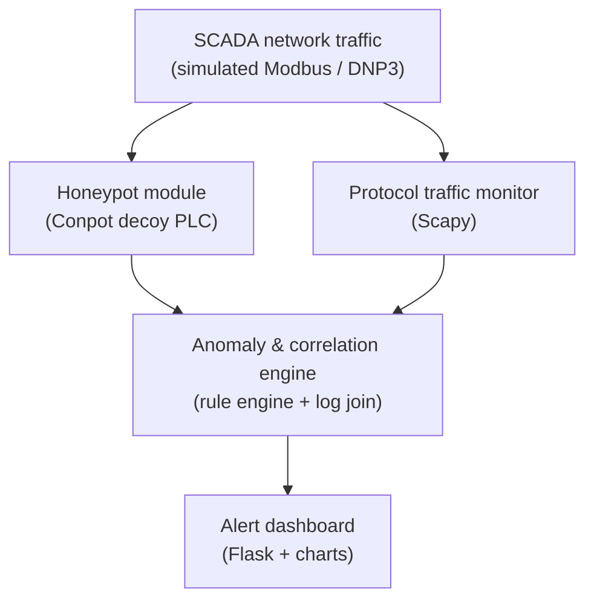

<div align="center">

# 📐 GridSnare — Technical Design Specification


*The source of truth for architecture, detection logic, and constraints.*
*See [`README.md`](README.md) for the project overview and live measured metrics.*

</div>

---

## 📋 Document Control

| Field | Value |
|---|---|
| Project name | GridSnare — SCADA Deception & Anomaly Detection System |
| Naming | One name throughout: the public/display name is "GridSnare"; code, folders, Docker services and images, loggers, and environment variables use "gridsnare" / "GRIDSNARE" |
| Document version | 1.1 |
| Status | Approved for build — Phase 1 implemented and validated; Phase 2 in progress (see [§21](#21-📊-current-status-against-success-criteria)) |
| Purpose | Independent cybersecurity research and portfolio project exploring SCADA/ICS deception (honeypots) and anomaly detection across Modbus and IEC 61850/GOOSE protocols |
| Classification | Educational / lab use only — no production or third-party systems involved |

---

## Table of contents

1. [🧭 Executive Summary](#1-🧭-executive-summary)
2. [❗ Problem Statement](#2-❗-problem-statement)
3. [🗂️ Scope](#3-🗂️-scope)
4. [⚖️ Rules of Engagement](#4-⚖️-rules-of-engagement)
5. [🎭 Threat Model](#5-🎭-threat-model)
6. [🏗️ System Architecture](#6-🏗️-system-architecture)
7. [🧩 Module Specifications](#7-🧩-module-specifications)
8. [🚨 Detection Logic](#8-🚨-detection-logic)
9. [🔄 Data Flow](#9-🔄-data-flow)
10. [🧰 Technology Stack](#10-🧰-technology-stack)
11. [🧪 Test Environment Setup](#11-🧪-test-environment-setup)
12. [✅ Validation & Test Plan](#12-✅-validation--test-plan)
13. [🎯 Success Criteria](#13-🎯-success-criteria)
14. [📦 Deliverables](#14-📦-deliverables)
15. [🗺️ Build Roadmap](#15-🗺️-build-roadmap)
16. [💼 Alignment with Job Description](#16-💼-alignment-with-job-description-hitachi-energy-r0139690)
17. [⚠️ Limitations & Future Work](#17-⚠️-limitations--future-work)
18. [🔒 Content Integrity Policy](#18-🔒-content-integrity-policy)
19. [📁 Repository Structure](#19-📁-repository-structure)
20. [⚡ Phase 2 Extension — IEC 61850 / GOOSE](#20-⚡-phase-2-extension--iec-61850--goose-deception--detection)
21. [📊 Current Status Against Success Criteria](#21-📊-current-status-against-success-criteria)

---

## 1. 🧭 Executive Summary

GridSnare is a SCADA/ICS security monitoring system that combines **deception** and
**detection**. A decoy programmable logic controller (PLC) attracts and logs unauthorized
access attempts, while a protocol-level traffic monitor inspects legitimate network traffic
for anomalous or out-of-spec commands. A correlation engine joins both data sources to raise
higher-confidence alerts than either technique produces alone, and a dashboard presents the
results.

The project is scoped as a solo, lab-based build demonstrating core competencies relevant to
industrial control system (ICS) cyber security: network security architecture, intrusion
detection, protocol-level analysis, and secure system monitoring.

---

## 2. ❗ Problem Statement

SCADA and HVDC control networks were originally designed for reliability and availability,
not security — many industrial protocols (Modbus, DNP3) have no built-in authentication or
encryption. As these networks increasingly connect to corporate IT and remote access points,
they become exposed to reconnaissance, unauthorized command injection, and lateral movement
from compromised hosts.

Two defensive techniques address this from different angles:

- **Deception** (honeypots) — detect attackers by luring them to a fake asset that has no
  legitimate reason to be touched.
- **Anomaly detection** — detect misuse of legitimate assets by flagging protocol behavior
  outside expected norms.

GridSnare implements both in a single, correlated pipeline.

---

## 3. 🗂️ Scope

### 3.1 In scope
- Simulated/lab SCADA network using Modbus TCP (and DNP3 if time allows)
- Honeypot deployment mimicking a PLC/HMI
- Real-time protocol traffic capture and parsing
- Rule-based anomaly detection
- Log correlation between honeypot and monitor
- Web-based alert dashboard
- Documentation: architecture, setup guide, README

### 3.2 Out of scope
- Any real, production, or third-party-owned SCADA/HVDC system
- Physical security controls (covered conceptually only, not built)
- Machine-learning–based detection (rule-based only, for v1)
- Multi-site / distributed deployment

---

## 4. ⚖️ Rules of Engagement

These boundaries apply for the entire build and test cycle:

1. All testing runs on an isolated lab network — local VMs or containers the developer owns
   and controls. No internet-facing exposure.
2. No scanning, probing, or traffic interception is performed against any network, device, or
   system the developer does not own or have explicit permission to test.
3. No real production SCADA, HVDC, or utility infrastructure is accessed, referenced with
   real identifying data, or simulated using real customer/site information.
4. All "attack" traffic used for testing is self-generated within the lab (e.g. a local
   Python script sending test Modbus packets) — never sourced from or aimed at third parties.

---

## 5. 🎭 Threat Model

### 5.1 Simulated assets
- 1× decoy PLC (Conpot, Modbus TCP)
- 1× simulated HMI/engineering workstation (traffic source for legitimate baseline)
- 1× monitoring host (runs the traffic monitor + engine + dashboard)

### 5.2 Threat actors considered

| Actor | Motivation | Behavior modeled |
|---|---|---|
| External scanner | Reconnaissance | Port/service scans, protocol probing |
| Unauthorized internal host | Misconfiguration or insider misuse | Out-of-scope writes, off-hours access |
| Compromised engineering workstation | Lateral movement | Unusual function codes, unexpected write patterns |

### 5.3 Reference frameworks
- **IEC 62443** — Industrial automation and control systems security (informs the network
  segmentation and monitoring approach)
- **NIST SP 800-82** — Guide to Industrial Control Systems (ICS) Security (informs detection
  rule categories)
- **MITRE ATT&CK for ICS** — used as a vocabulary reference for labeling detected behaviors
  (e.g. T0846 Remote System Discovery, T0855 Unauthorized Command Message)

---

## 6. 🏗️ System Architecture



---

## 7. 🧩 Module Specifications

### 7.1 Honeypot module (Conpot)
- Deploys Conpot's default or a custom Modbus/IEC template to simulate a PLC/HMI
- Logs every connection attempt: source IP, timestamp, protocol commands issued
- Any interaction is inherently suspicious — a decoy has no legitimate traffic

### 7.2 Protocol traffic monitor
- Uses Scapy to capture live Modbus TCP packets on the lab network
- Parses: source/destination IP, function code, register address, value, timestamp
- Writes structured events to the shared data store

### 7.3 Anomaly & correlation engine
- Applies rule set (Section 8) to monitor events
- Cross-references monitor events and honeypot events by source IP within a rolling time
  window
- Assigns severity: Low / Medium / High / Critical
- Writes alerts to the data store

### 7.4 Data store
- SQLite database, two core tables: `raw_events` and `alerts`
- Indexed on source IP and timestamp for correlation queries

### 7.5 Alert dashboard
- Flask app reading from the data store
- Views: live alert feed, severity breakdown chart, timeline, honeypot vs. monitor event
  split
- No authentication needed for a local lab demo; note this as a limitation if extended
  beyond localhost

---

## 8. 🚨 Detection Logic

| ID | Rule | Rationale | Severity |
|---|---|---|---|
| DR-1 | Any interaction with the honeypot | Decoy has no legitimate traffic | Critical |
| DR-2 | Modbus function code outside an allow-list of expected codes | Indicates protocol misuse or reconnaissance | High |
| DR-3 | Write request to a register outside the defined operational range | Potential unauthorized control action | High |
| DR-4 | Access outside defined operational hours | Deviates from expected baseline usage | Medium |
| DR-5 | Source IP/MAC not on the known-asset allow-list | Unrecognized device on the network | Medium |
| DR-6 | Abnormally high polling/request frequency from one source | Possible scanning or fuzzing behavior | Medium |
| DR-7 | Correlated hit: same source IP in both honeypot and monitor logs within N minutes | Multi-stage attack indicator | Critical |

Thresholds (allow-lists, operational hours, polling rate limits) are configurable, not
hardcoded — stored in a `config.yaml` so the system can be tuned without code changes.

---

## 9. 🔄 Data Flow

1. Traffic monitor captures a packet → parses fields → writes to `raw_events`
2. In parallel, any honeypot interaction is logged to `raw_events` with `source=honeypot`
3. Correlation engine polls `raw_events` on an interval, applies DR-1 through DR-7
4. Matches are written to `alerts` with severity and rule ID
5. Dashboard queries `alerts` and `raw_events` for display, refreshing on a short interval

---

## 10. 🧰 Technology Stack

| Component | Technology | Justification |
|---|---|---|
| Honeypot | Conpot | Purpose-built open-source ICS honeypot; supports Modbus out of the box |
| Packet capture/parsing | Python + Scapy | Fine-grained control over protocol field extraction |
| Rule engine | Python (custom) | Full control over ICS-specific logic; no ML dependency needed for v1 |
| Data store | SQLite | Zero-config, sufficient for single-host lab scale |
| Dashboard | Flask + Chart.js | Full control over layout/styling — doubles as a frontend portfolio piece, not just backend logic |
| Lab network | VirtualBox/VMware or Docker | Isolated, reproducible, no risk to any real network |

---

## 11. 🧪 Test Environment Setup

- All components run on isolated VMs or Docker containers on a host-only/internal virtual
  network (no bridged adapter to a real network)
- One VM/container hosts Conpot; one hosts the monitor + engine + dashboard
- **A fourth, required component**: a legitimate (non-decoy) Modbus PLC simulator — e.g. a
  plain `pymodbus` server — that baseline/legitimate traffic actually targets. This is not
  optional: the honeypot has no legitimate traffic by design (Section 7.1), so "baseline
  traffic" sent at the honeypot instead of a real asset is not a valid no-false-positive
  test — it's traffic the honeypot is correctly supposed to flag. The same applies on the
  GOOSE side (Section 20): a legitimate GOOSE publisher distinct from the decoy IED is
  required for TC-8.
- No internet exposure at any point during testing

---

## 12. ✅ Validation & Test Plan

| Test case | Steps | Expected result |
|---|---|---|
| TC-1: Honeypot detection | Send a benign Modbus read request to the honeypot's IP from a lab test script | Event logged, DR-1 fires, Critical alert appears on dashboard |
| TC-2: Baseline traffic (no false positive) | Run expected/whitelisted Modbus traffic pattern for 10 minutes, targeting the legitimate PLC simulator (Section 11) — never the honeypot | No alerts generated |
| TC-3: Function code anomaly | Send a Modbus request using a function code outside the allow-list | DR-2 fires, High alert generated |
| TC-4: Out-of-range write | Send a write request to a register outside the defined operational range | DR-3 fires, High alert generated |
| TC-5: Correlation | Trigger both a honeypot hit and a monitor anomaly from the same source IP within the correlation window | DR-7 fires, Critical alert, both source events linked in dashboard view |
| TC-6: Dashboard accuracy | Compare dashboard alert count/severity against raw `alerts` table | Counts match exactly |

*Measured, per-run results for every case above are tracked in [`README.md`](README.md) and
summarized in [§21](#21-📊-current-status-against-success-criteria) below.*

---

## 13. 🎯 Success Criteria

- All six test cases in Section 12 pass consistently across 3+ runs
- Dashboard correctly displays and distinguishes honeypot-only, monitor-only, and correlated
  alerts
- System runs end-to-end from a documented setup process without manual database edits
- README allows a third party to reproduce the lab setup from scratch

---

## 14. 📦 Deliverables

1. Public GitHub repository with full source code
2. This specification document (`docs/SPEC.md`)
3. README with setup instructions and architecture diagram
4. Demo screenshot(s) or short screen recording of a simulated attack being caught
   end-to-end
5. Resume bullet point(s) derived from actual, verified project outcomes only

---

## 15. 🗺️ Build Roadmap

| Phase | Milestone |
|---|---|
| 1 | Lab network + Conpot honeypot running and logging |
| 2 | Scapy traffic monitor capturing and parsing Modbus packets |
| 3 | Rule engine (DR-1 to DR-6) implemented and unit-tested |
| 4 | Correlation logic (DR-7) implemented |
| 5 | Dashboard built and connected to live data |
| 6 | Full test plan executed (Section 12), issues fixed |
| 7 | Documentation, screenshots, and repo cleanup |

---

## 16. 💼 Alignment with Job Description (Hitachi Energy, R0139690)

| JD requirement | GridSnare component |
|---|---|
| Adapting HVDC cyber security for SCADA & HMI | Honeypot simulates PLC/HMI; monitor inspects SCADA protocol traffic |
| Design & develop secured network architecture for SCADA | Overall system architecture (Section 6) and lab network segmentation |
| Implement internal/external intrusion detection systems | Honeypot module + anomaly engine together form the IDS |
| Technical audits of SCADA devices and networks | Test plan (Section 12) mirrors an audit/validation process |
| Networking, security knowledge | Protocol-level packet parsing, network segmentation, correlation logic |
| Basic knowledge of IEEE/IEC standards | IEC 62443 and NIST SP 800-82 referenced as design inputs (Section 5.3) |
| Basic C/C++, SCADA project experience | Python used for v1; C/C++ extension noted in Section 17 as a possible future iteration for the parser |

---

## 17. ⚠️ Limitations & Future Work

- Rule-based detection only — no statistical or ML-based anomaly detection in v1
- Tested against Modbus TCP primarily; DNP3 support is a stretch goal
- Single-host dashboard with no authentication — acceptable for a local demo, not
  production-ready
- Possible future extension: reimplement the packet parser in C/C++ for a lower-level
  systems demonstration, directly relevant to the JD's C/C++ mention

---

## 18. 🔒 Content Integrity Policy

This applies to all code, comments, documentation, and any resume/interview material derived
from this project:

- No fabricated performance metrics, benchmarks, detection rates, or accuracy figures. Only
  numbers actually observed during real test runs are used, and only if reproducible.
- No claimed certifications, endorsements, or third-party validation that did not occur.
- No claimed production deployment or real-world incident detection — this is explicitly a
  lab/educational project and must be described as such.

---

## 19. 📁 Repository Structure

```
GridSnare/
├── docs/
│   └── SPEC.md                # this document
├── honeypot/
│   └── conpot_config/
├── goose/                      # Phase 2 — see Section 20
│   ├── decoy_ied.py
│   └── goose_monitor.py
├── monitor/
│   └── traffic_monitor.py
├── engine/
│   ├── rules.py                # DR-1..DR-7 (Modbus)
│   ├── goose_rules.py          # GR-1..GR-5 (Section 20.3)
│   ├── autoencoder.py          # optional PyTorch model, GR-5
│   └── correlator.py
├── dashboard/
│   ├── app.py
│   └── templates/
├── data/
│   └── events.db
├── tests/
│   └── test_scenarios.py
├── config.yaml
├── README.md
└── requirements.txt
```

---

## 20. ⚡ Phase 2 Extension — IEC 61850 / GOOSE Deception & Detection

### 20.1 Rationale

Phase 1 (Sections 1–19) targets Modbus TCP, a generic industrial protocol common to
factory-floor and water/oil-and-gas SCADA. Phase 2 extends GridSnare to **IEC 61850**,
specifically the **GOOSE** (Generic Object Oriented Substation Event) protocol used for
protection-relay trip commands in substation automation — the protocol domain underlying
grid and HVDC control systems. GOOSE has no built-in authentication in most legacy
deployments, which is why the IEC 62351 security extension exists for it. This phase is
scoped narrower than a full production security tool: it demonstrates the detection
principles a real deployment would use.

### 20.2 New components

| Component | Role |
|---|---|
| Decoy IED | Fake protection relay publishing GOOSE messages via libiec61850 (open-source C library implementing MMS, GOOSE, and Sampled Values). Also has its own raw-socket (AF_PACKET) receive path with a BER decoder, so it can hear GOOSE traffic addressed to it independently of the separate GOOSE traffic monitor below |
| GOOSE traffic monitor | Captures raw Ethernet multicast GOOSE frames (EtherType 0x88B8) and extracts StNum, SqNum, source MAC, GoCB reference, and timestamp — this is the component GR-1 through GR-4 key off, not the decoy's own receive path |
| GOOSE detection rules | Validates sequence and timing behavior against IEC 61850-8-1 expectations |
| PyTorch autoencoder (optional, stretch) | Unsupervised anomaly scoring on GOOSE timing/sequence feature vectors, to catch anomalies the static rules miss |

### 20.3 GOOSE Detection Logic

| ID | Rule | Rationale | Severity |
|---|---|---|---|
| GR-1 | StNum/SqNum sequence violation (e.g. SqNum resets without a StNum increment, or duplicate StNum/SqNum pairs from the same publisher) | Indicates a replayed frame — a legitimate publisher's sequence numbers follow a defined pattern on state change vs. heartbeat retransmission | High |
| GR-2 | Source MAC address does not match the known-publisher allow-list for a given GoCB reference | Indicates spoofing — a legitimate relay's MAC is fixed and known | Critical |
| GR-3 | Retransmission interval deviates from the configured GOOSE timing profile (fast retransmission burst after a state change, decaying to a steady heartbeat) | Anomalous timing suggests an unauthorized or malfunctioning publisher | Medium |
| GR-4 | Any GOOSE traffic referencing the decoy IED's GoCB | Decoy has no legitimate subscribers/publishers | Critical |
| GR-5 (stretch) | PyTorch autoencoder reconstruction error on the (StNum delta, SqNum delta, inter-arrival time) feature vector exceeds a trained threshold | Statistical anomaly not captured by hard-coded rules | Medium |

These join the existing DR-1 through DR-7 (Section 8) in the same correlation engine and
`alerts` table, distinguished by a `protocol` field (`modbus` or `goose`).

### 20.4 Test Environment Note

GOOSE test traffic (including intentionally malformed/replayed frames for validating GR-1
through GR-4) is generated entirely within the isolated lab network described in Section 11,
using libiec61850's own publisher API to simulate both legitimate and anomalous sequences.
This mirrors how academic research in this space validates GOOSE intrusion detection —
modeling attack patterns in a closed testbed to evaluate detection, not to target real
infrastructure. Section 4's Rules of Engagement apply unchanged.

### 20.5 Required Environment

| Requirement | Already have? | Notes |
|---|---|---|
| Docker Desktop | Yes | Runs libiec61850 build + all services; avoids native Windows compilation entirely |
| Python 3.x | Yes | Monitor, engine, dashboard |
| PyTorch | Yes | Only needed for optional GR-5 autoencoder |
| VS Code | Yes | Editing/reviewing, not required by the build itself |
| Wireshark | Recommended, not required | Useful for manually inspecting GOOSE frames during development; skip if relying on Docker-internal capture only |

No other software is required. libiec61850 is built inside the Docker image, not installed
on the host.

### 20.6 Phase 2 Validation & Test Plan

Mirrors the Phase 1 test plan (Section 12). Each test case should be implemented as an
actual automated test in `tests/test_scenarios.py`, not just documented here.

| Test case | Steps | Expected result |
|---|---|---|
| TC-7: Decoy detection | From a lab test script, send a GOOSE frame referencing the decoy IED's GoCB | GR-4 fires, Critical alert appears on dashboard |
| TC-8: Baseline traffic (no false positive) | Run expected/whitelisted GOOSE publisher traffic for a defined period, from a legitimate publisher distinct from the decoy IED (Section 11) — never the decoy | No GOOSE alerts generated |
| TC-9: Replay detection | Capture a legitimate GOOSE frame sequence, retransmit it out of the expected StNum/SqNum order | GR-1 fires, High alert |
| TC-10: Spoofing detection | Transmit a GOOSE frame using a source MAC not on the publisher allow-list for that GoCB | GR-2 fires, Critical alert |
| TC-11: Timing anomaly | Transmit GOOSE frames at an interval inconsistent with the configured retransmission profile | GR-3 fires, Medium alert |
| TC-12 (stretch, only if GR-5 is built) | Feed the autoencoder a feature vector outside the trained distribution | GR-5 fires, Medium alert |
| TC-13: Unified dashboard check | Trigger one Modbus alert (TC-1 to TC-6) and one GOOSE alert together | Dashboard correctly shows both, tagged with the right `protocol` value, no cross-contamination |

Phase 2 success criteria mirror Section 13: all applicable test cases above pass
consistently across 3+ runs before Phase 2 is considered done.

### 20.7 Alignment with Job Description

Phase 2 directly strengthens the "Basic knowledge on IEEE/IEC standards" and "adapting HVDC
cyber security for SCADA & HMI" JD lines: IEC 61850 is the substation automation standard
underlying Hitachi Energy's actual grid and HVDC product domain, distinct from the generic
Modbus focus of Phase 1.

---

## 21. 📊 Current Status Against Success Criteria

This section maps the qualitative targets in **Section 13** to the actual, measured outcomes
recorded in `README.md` — evidence, not restated intent, per the Content Integrity Policy
(Section 18).

| Section 13 criterion | Target | Measured outcome |
|---|---|---|
| All six Phase 1 test cases pass across 3+ runs | ≥ 3 consecutive full-suite runs | **Met** — 6/6 cases passing across 6 independent full runs (3 with detection started by hand, 3 with it running as a service) |
| Dashboard distinguishes honeypot-only / monitor-only / correlated alerts | Qualitative | **Met** — TC-6 confirms dashboard and `alerts` table agree exactly on totals, severities, and the correlated subset (140 / 376 alerts, 37.2%) |
| Runs end-to-end without manual database edits | Qualitative | **Met** — detection engine runs as a persistent compose service; clean-room teardown/rebuild verified zero manual steps |
| README allows third-party reproduction from scratch | Qualitative | **Met** — Quick Start and clean-room reproduction steps are documented and were the actual steps measured |

**Phase 2 (Section 20.6)** remains in progress: GR-1 through GR-4 and TC-7–TC-11/TC-13 are
not yet implemented. Current gaps, each bounded by direct measurement rather than assumption,
are tracked in `README.md`'s Known Limitations section.

---

<div align="center">

**Lab-isolated only — no real production SCADA/HVDC system is ever touched.**

</div>
